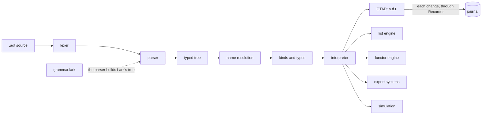
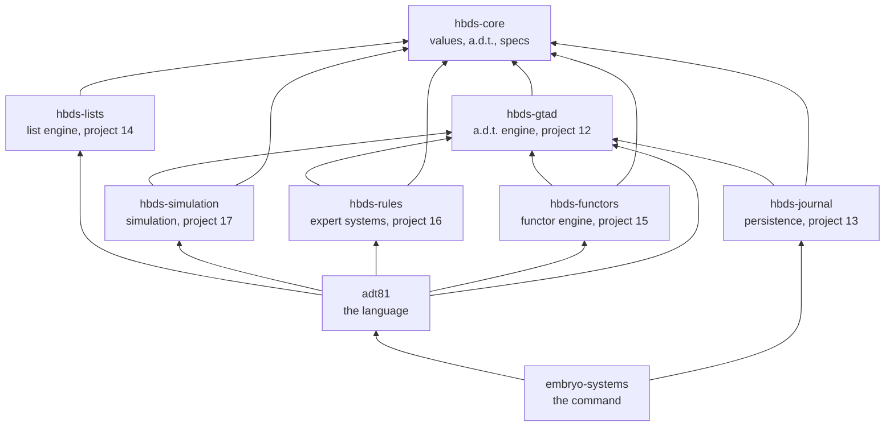

# embryo-systems

Rebuilding François Bouillé's HBDS system from his 1995 course notes, the
polycopié, in Rust.

HBDS (*Hypergraph-Based Data Structure*) models a world as classes and
objects, their attributes and the links between them, queried by
functors. ADT'81 is its programming language. The scans and their
transcriptions live in the private `embryo-systems-archive`. This
repository quotes and cites them, and copies nothing from them. The site
is `embryo-systems.info`.

## Quick start

With Nix, `direnv allow` once, or `nix develop`: the flake carries every
tool. Without it, a Rust toolchain of 1.89 or later (edition 2024, let-chains, file locks) builds
and tests everything; the grammar gate also needs Python 3 with
[Lark](https://github.com/lark-parser/lark), and the recipes
[just](https://github.com/casey/just). Then:

```sh
cargo run -q -- run crates/adt81/tests/corpus/run/hello.adt      # Hello, world!
cargo run -q -- check crates/adt81/tests/corpus/checked/roads.adt # names and types
cargo run -q -- run --store /tmp/hydro crates/adt81/tests/corpus/run/store/functors.adt
cargo run -q -- store /tmp/hydro                                   # what the store keeps
```

| command | what it does |
|---|---|
| `embryo-systems run [--store DIR] FILE` | checks a program, compiles it to A-code and runs it on the VM. Its classes and objects last the run, or stay in the store in DIR for the next program. READ reads stdin, PRINT writes stdout. |
| `embryo-systems run [--store DIR] --reference FILE` | the same on the interpreter, the VM's specification |
| `embryo-systems acode FILE` | the program compiled to A-code, as text: an `.acode` file |
| `embryo-systems exec [--store DIR] FILE` | runs an `.acode` file on the VM |
| `embryo-systems daemon --socket SOCKET [--store DIR] [--pace paused\|fast\|real]` | serves a store on a Unix socket; `run`, `exec` and built programs take `--connect SOCKET` to run there, clients taking turns; one time for the store, its processes outliving their clients, at a pace `POST /pace` changes |
| `GET /events`, `GET /sessions`, `POST /sessions/ID/kill` | on a daemon's socket: the feed of what happens (changes, sessions, time, processes' output), the sessions, killing one |
| `embryo-systems build FILE -o OUT` | writes OUT, an executable carrying the program: `OUT [--store DIR]` runs it, anywhere on this platform |
| `embryo-systems check FILE` | undeclared and misused names, type errors |
| `embryo-systems compact DIR` | rewrites a store's journal as the shortest that rebuilds it |
| `embryo-systems store DIR` | prints a store's contents |
| `embryo-systems fmt FILE` | the program in canonical form |
| `embryo-systems parse FILE`, `lex FILE` | the syntax tree, the tokens |

`crates/adt81/tests/corpus/run/` holds programs to run, each with its expected output.
`just bench` runs the benchmarks of `bench/scenarios/`: their work must
match `bench/work.txt`, their times this host's `bench/<host>.txt`, if it
has one; `just bench-record` writes both.

## What works

- **ADT'81, the whole language:**
  - a grammar derived from the print's BNF and checked against the polycopié's eleven code listings
  - a parser checked tree for tree against Lark
  - a checker for names, types and fuzziness
  - an interpreter, covering every number type (Gauss integers and quaternions included), fuzzy arithmetic, lists, arrays, modules, functors and coroutines
- **The HBDS store:** classes, objects, attributes, links and their reverses, states, hyperclasses, every functor of the catalogue, and computed attributes. It is in memory, and made durable by a journal.
- **COND and ACTION:** the constraints and actions a.d.t. carry run when the a.d.t. changes. A statement is a transaction: it is kept whole, or refused whole.
- **Discrete simulation:** processes, objects of classes in the hyperclass PROCESS, run their bodies as coroutines, ordered by a sequencing set as in SIMULA 67; the main program's HOLD lets them run, and ACTIVATE, REACTIVATE, CANCEL, DELAY, KILL, PASSIVATE and TERMINATE move them as figure 52 has it.
- **Expert systems:** rules are objects of classes in the hyperclass RULE, their premises and consequents code compiled when written; CHAV chains them forward, HYPOCHAV from hypotheses, with the print's ten parameters (priority, reliabilities, askability, activation and inhibition among them), and INRULE, OUTRULE, INFACT and OUTFACT walk them.
- **The polycopié's own code runs:** pages 127-128's computed attributes ARC.LENGTH and AREA.PERIMETER give the right answers on a test schema, once three print errors are corrected.

Every departure from the print, and every decision the print left open, is recorded with its page in [docs/adt81.md](docs/adt81.md) and [docs/hbds.md](docs/hbds.md).

## How it fits together

A program goes through the language's layers, then reaches the engines:



Each engine is a crate of its own, as in the print, where each engine (*moteur*) is a project of its own. A language is a crate that uses the engines. Dependencies only go downward, and `just engines` enforces it:



| crate | what |
|---|---|
| `crates/hbds-core` | the vocabulary the engines share: values, a.d.t. references and kinds, specifications |
| `crates/hbds-values` | what operations do to values: every number type, widening, fuzziness carried along, arrays |
| `crates/hbds-maps` | the persistent B-tree the store keeps its model and indexes in |
| `crates/hbds-gtad` | the a.d.t. engine: model, indexes, changes, states, transactions |
| `crates/hbds-lists` | the list engine: cursors, circular lists, list functors |
| `crates/hbds-functors` | the functor engine: the catalogue of pages 76 to 80 |
| `crates/hbds-journal` | GTAD's persistence, a journal in the spirit of the print's DAYFILE |
| `crates/hbds-rules` | the expert systems: rules and facts, SES's four functors, CHAV and HYPOCHAV |
| `crates/hbds-simulation` | the discrete simulation: PROCESS, the sequencing set, figure 52's primitives |
| `crates/adt81` | ADT'81: grammar, parser, checker, interpreter |
| `src/main.rs` | the `embryo-systems` command |

## Documentation

- [docs/adt81.md](docs/adt81.md): the language. How the grammar was derived, every departure from the print, the checker, and running.
- [docs/architecture.md](docs/architecture.md): how it runs, and where it is going. The layers, A-code and its VM, the daemon, standalone builds, persistence, time, and the order of the steps.
- [docs/hbds.md](docs/hbds.md): the engines. The model, inheritance, COND and ACTION, transactions, the expert systems, the simulation, the journal, open questions.

## Roadmap

The system's own steps (A-code and a VM, standalone builds, a daemon with a web UI) are ordered in [docs/architecture.md](docs/architecture.md). The print's other engines, each to be a crate of its own, come between them:

| engine | print |
|---|---|
| neurons and reflexes | project 18, pages 116 to 131 |
| dialog, the Q-Graph | project 19, pages 133 to 149 |
| constraints: MAY, MUST, CANNOT, and the CONSTRAINT hyperclass | pages 157 to 160 |
| SFSI and ZE, the print's own file system and exchange zone, as another persistence | project 13, pages 86 to 105 |
| NINJAS, protection against object-oriented viruses | project 20, page 150 |
| ADTmin, precompilers to C, Ada, Pascal and Fortran | page 161 |

On NixOS, the flake's `nixosModules.default` runs the daemon as a service:

```nix
services.embryo-systems = {
  enable = true;
  pace = "real";
};
```

## Develop

The flake's dev shell, loaded by direnv, carries every tool, and `just` lists the recipes. `just check` is exactly what CI runs, on Forgejo where the project lives and on its GitHub mirror alike:

- formatting and clippy
- every test
- `just check-grammar`: the grammar parses each test program and 200 random ones one way only, to the Rust parser's tree
- `just engines`: each crate depends only on what it may
- `just docs`: every path and link in the documentation exists
- the confusable-characters check
- `just module`: a NixOS system with `nixosModules.default` enabled gets the daemon's service

## License

The code is under the MIT license ([LICENSE](LICENSE)). The polycopié,
its text, figures and code listings, is François Bouillé's: this
repository quotes and cites it, page by page, and does not reproduce it.
