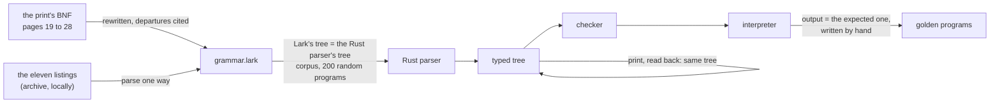

# ADT'81

ADT'81 is the programming language of François Bouillé's HBDS system. Its
definition is the "BNF simplifiée" printed in the 1995 polycopié, pages 19 to
28, with the abbreviations of page 29 and the notation of figure 1, page 17.
The polycopié itself is not in this repository: its copyright is under review,
so this project quotes and cites it, and carries none of it.

`crates/adt81/grammar.lark` is our grammar of the same language, and
`crates/adt81` its implementation. This page tells how the grammar was
obtained, where it departs from the print and why, then what the checker
checks and how programs run.

## Method

1. **Transcription.** The pages were scanned, cleaned and transcribed in a
   private archive, each page checked against its image.
2. **The print's BNF, verbatim.** Pages 19 to 28 were assembled into one file
   as printed, with every rule the print uses but never defines, defines but
   never uses, or defines twice declared explicitly.
3. **A grammar a parser accepts.** That text is not parser input: its
   brackets are overloaded, rules are missing, and the code the polycopié
   quotes does not follow it. It was rewritten as a Lark grammar, each
   departure commented with its page.
4. **Tested on the polycopié's own code.** The eleven code listings the
   polycopié quotes (pages 49-51, 76-79, 127-128, 152-158) all parse. Sixteen
   print errors in them had to be fixed first (a missing quote, a missing
   `;`, a keyword misspelt `APPRO`...), each checked on the page image.
5. **Unambiguous on purpose.** Every listing, and a test program with one of
   each construct, must parse in exactly one way. Removing the print's
   redundant alternatives took the count of ambiguous points in the listings
   from 326 to 0.
6. **Our grammar.** This repository's grammar was written afresh from that
   work, with our rule names and structure. It still accepts all eleven
   listings, unambiguously, and the Rust lexer produces the same tokens as
   Lark on all of them.
7. **A parser in Rust.** Hand-written, recursive descent, one function per
   rule of the grammar, building the grammar's own tree. On every test
   program and on the eleven listings it builds the same tree as Lark, node
   for node, and it refuses every reject.
8. **A typed tree.** The parser's tree is lowered to an abstract syntax
   tree for the checker, and a printer writes it back as source. Random
   programs, generated from that tree, check both ways: printed and read
   back, each gives the tree it came from; and Lark reads each printed
   program one way only, to the Rust parser's tree. That search found one
   more statement the grammar read two ways, settled below.
9. **A checker and an interpreter** on that tree, each rule tested on
   programs written for it, with outputs written by hand before the first
   run.

Each layer is checked against the one before it:

## The print's notation

Figure 1 (page 17) gives the BNF's operators through the transformations the
course's compiler-compiler (the "C2") applies to them:

| print | meaning | here |
|---|---|---|
| `[ a \| b ]` | one of ("un parmi") | `(a \| b)` |
| `[ a ]` | optional ("facultatif") | `a?` |
| `{ a }` | one or more ("itératif") | `a+` |
| `[{ a }]` | zero or more | `a*` |

Brackets also stand for themselves in a few rules (array bounds, indices, an
object's class); context tells which, and the grammar quotes those, `"["`.

## Departures from the print

### Errors of the print

| page | in the print | here |
|---|---|---|
| 20 | `MATRIX` alternative lacks its `\|`, `TENSOR` a closing bracket (a handwritten note adds both) | added |
| 20 | initial value or constant is "one of" | optional |
| 22 | `AFTER`/`BEFORE` position is "one of" | optional |
| 22, 25 | the index rule is defined twice | one rule, an expression |
| 23 | the operand list of a state change appears twice | once |
| 23 | an object link ends in an object name; a handwritten note corrects it to a link name | corrected |
| 19, 24 | the parameter specification and the `SPECIFY` statement share a name | two rules |
| 24 | `of` in lower case | `OF` |
| 25 | a stray bracket after `AT`, marked "pb" by hand | removed |
| 25, 27 | two alternatives end in a dangling `\|` | removed |
| 26 | the sign of a constant is "one of" | optional |
| 26 | the float operators read `*` and `-` | `*` and `/`, as for complex numbers |
| 27 | `AND` joins exactly two terms | any number, as `OR` |
| 27 | a functor's prefix may be a bare expression, so `a + b'F` would apply `F` to `a + b` | parenthesised, `(a + b)'F` |

### Gaps, filled by analogy

- **Comparator** (page 27, never listed): `= /= < <= > >=`.
- **A.d.t. operand** (page 27, never defined): page 29 expands the
  abbreviation as "type abstrait de donnée"; any designated class, object,
  attribute or link.
- **Right operand of `COMPL`** (page 28): a list term, as on its left.
- **Object attribute expression** (pages 26, 27): page 23's object attribute.
- **Gauss, quaternion and rational expressions** (page 27, "pas à traiter",
  not to be handled): nothing to add, since expressions are untyped.

### Constructs the polycopié's code uses

The listings are later than the BNF and use more than it defines: a
computed attribute's algorithm named after the attribute
(`FUNCTION "ARC"."LENGTH"`, pages 49-50); a functor naming its prefix
(`FUNCTOR C'COUPLE(D)`, page 76); `DESIGN` of attributes and links
(pages 49, 51); `SPECIFY` with a colon, `COMPUTED`, a `UNIT`, and on classes
and links (pages 49, 154, 158); properties of an a.d.t. such as `COND` and
`ACTION` (pages 156-158); array operators `[+] [*] [.] [^]` (page 153);
fuzzy values (pages 152-154, below); `HOLD FOR dt` without an object
(page 125, where the BNF's page 25 names one); declarations and
statements quoted outside any module (the `fragment` start symbol).

### Structure

- **Expressions are untyped.** The print splits arithmetic by type (integer,
  float, complex, Gauss, quaternion, rational), and each split starts with an
  identifier whose type only its declaration knows. One expression grammar
  replaces them, by precedence, loosest first: `OR NOR XOR`, `AND NAND`,
  `NOT`, comparisons and `IN NOTIN`, `UNION`, `INTER`, `COMPL`, `&`,
  `+ -`, `* / MOD //`, `^`. The print gives no precedence across types; this
  order is ours.
- **A bare name is one rule.** The print gives each kind of a.d.t. its own
  identifier rule (page 24). With bare names the kinds read alike, so
  designations are one rule per shape (a name, `"A" . "x"`, `a "r" b`,
  `"P" [ "C" ]`), and whether a name is a class or an object is the
  checker's. The same holds for `CREATE` lists and `ASSOC`/`DISSOC` pairs.
- **A list expression after `EACH ... OF`**, page 28's own form, so that the
  `/` introducing the filter is never read as a division.
- **A functor result inside a designation** is written in parentheses,
  `LET (a'F) . "x" ' COND := ...`; otherwise `a'F'G` would read two ways.

## Decisions

The print leaves these open; they were decided on 2026-10-14.

- **Imaginary units are suffixes**, `2.3 + 3.4i`, as in Go. Page 26 writes
  them as prefixes (`i 3.4`) and page 153 says `i` "works like an operator",
  which collides with a call to a function named `i`. Considered: reserving
  `i`, `j`, `k` as prefix keywords (faithful, but no variable could be called
  `i`), or leaving the checker to tell a call from a unit (MATLAB's choice,
  and its known pitfall). The suffix needs no reserved name and no
  context.
- **`%` is a probability only.** Page 26 lists it among the integer
  operators; the fuzziness paper (page 152) uses it for the probability of a
  value. Integer division is `/`.
- **Fuzziness attaches to number literals only:** an approximation `+-`, a
  probability `%`, an opinion `@"..."`, in that order, and `{ }` for a value
  with several possibilities. Every example in the polycopié is a literal; a
  variable becomes fuzzy by declaration and assignment. The plain form is
  kept: a delimited form (backticks were considered) would clash with
  Markdown and with the `'` of functors, for no gain in parsing.
- **A link's relationship is a string literal**, as in every listing:
  `"AREA" "neighbor" "AREA"`. Page 23 allows any string expression, which
  makes three juxtaposed names a link, a boolean and more at once.
- **`LET` is required to set an a.d.t.'s property** (page 23, page 156).
  Page 158 drops it; that is read as a print error.
- **The language is case-insensitive**, names and keywords alike. *This is
  a deviation from the original document, taken deliberately.* The polycopié
  prints every keyword in upper case and underlined, and nothing in it shows
  a keyword written otherwise; we accept `loop`, `Loop` and `LOOP` as the
  same keyword. For names it follows the print: page 50 writes the functor
  `opscrc` where page 127 writes `OPSCRC`, so `xi`, `XI` and `Xi` are one
  name. It is worth it: with names folded and keywords not, `loop` would be
  a name and `LOOP` a keyword, a trap in any program; one rule for every
  word, as in Pascal or Ada, removes it. Every program the polycopié quotes
  parses the same as before, and ours keep the print's upper-case keywords.
  Considered and rejected: keywords in upper case only (the trap above), and
  keywords reserved in every case but required in upper case (stricter than
  any reader needs). Strings keep their case, but the names of a.d.t. that
  strings give compare folded too: `"ARC"` and `"arc"` are one class
  (docs/hbds.md).
- **A designation names an a.d.t. by one term**: a name, a string, a call
  or a parenthesised expression, where page 23 allows any string
  expression. Writing the parser showed three statements the grammar read
  two ways, none of them in the polycopié's code. The decision settles them
  as precedence, and gives the bracket after a name one meaning:
  - `'` and `.` bind tighter than `&`, as postfix operators do in most
    languages: `"A" & "B" ' F` is `"A" & ("B" ' F)`, and `a . "x" & "y"`
    is `(a . "x") & "y"`. Parentheses give the other reading,
    `("A" & "B") ' F`.
  - In a designation, a bracket after a name is the class, as the print
    writes `"P" [ "POINT" ]`: `CREATE p ["C"]` creates the object `p` of
    class `"C"`. A class named by an indexed variable is written
    `CREATE (T[i])`.
- **A function named after a computed attribute is named by two string
  literals**, `FUNCTION "ARC" . "LENGTH"`, as every listing writes it
  (decided 2026-10-15). A heading is read before anything runs, so a
  computed name has nothing to compute it with; allowed, it also made
  `FUNCTION "A" . p (x)` read two ways: the attribute `p` with a parameter
  `x`, or the attribute named by the call `p(x)`.
- **A process class's body is a coroutine named by the class's string**,
  `COROUTINE "PUMP"` (decided 2026-10-15): figure 51 gives every process
  class a BODY "of type coroutine", and the print no way to write one;
  named so, as a computed attribute's function is. `HOLD x FOR dt` holds
  the running process only, which page 125's `HOLD FOR dt` names
  implicitly.
- **THIS is a value**, the object it stands for, `PRINT THIS` (decided
  2026-10-15): the print uses it only before a part, `THIS."temp"`
  (page 158), and a process's body needs to name its process.
- **TIME is the simulation's time**, a built-in name, SIMULA's `time`,
  that a variable of that name hides (decided 2026-10-15): the print gives
  no way to read the time. *Not the print's.* A call needs an argument
  (page 27's expression list), so it is a name, not `TIME()`.
- **A quote written twice inside a string is a quote**, `"say ""hi"""`,
  as in Pascal and Ada (decided 2026-10-15). A string held no quote
  before, so a COND could not name an attribute: page 158's
  `THIS."temp" > 0.` is meant as a string, and only this makes it one,
  `"THIS . ""temp"" > 0."`.
- **`EXIT`, `NEXT`, `RELOOP` take an optional count**, one by default. Page
  22 always writes it.
- **Nesting has limits** (decided 2026-11-15), which no rule of the
  grammar can write: statements nest 64 deep, and an expression's tree is
  at most 256 high, parentheses, `NOT`, arguments and indexes counting
  one each, and each operator of a chain (`a + b + c`, `a & b`,
  `x ' F ' G`) one for all that is on its left, since the chain's tree
  leans left. Length is free: statements in sequence, the items of a
  list. The parser refuses the rest, with its place: 100 000 parentheses,
  or as many terms in one sum, overflowed the stack of `check`, `run`
  and `fmt`, in the parser or in a pass after it, each of which walks
  the tree by recursion. *Not the print's*, whose limits are of another
  kind: page 32 gives a module at most 256 instructions, 256
  identifiers, 256 constants and 256 expressions, a job 65 536 modules
  and a string as many characters, generation parameters all, and says
  nothing of nesting. Those sizes are not enforced here; the 256 is in
  their spirit. Not chosen:
  passes that walk without recursion, each to rewrite and none ever
  done, the next pass being written the plain way.

## Name resolution

The checker's first layer, `embryo-systems check`: every name a program
uses is declared, and known as what it is. It takes programs only;
fragments are excerpts, with no module to declare their names.

- A module is defined once per file. The modules of a file see one another;
  `EXTERNAL` declares the modules compiled elsewhere, and may name one of
  the file's, if of the same kind (decided 2026-10-15).
- Each formal parameter is listed once and specified once; only formal
  parameters are specified. A local is declared once, and is not a
  parameter; an external clashes with neither.
- A variable is a local or a parameter, or, inside a functor, the
  functor's own name, which holds its result (`COUPLE := ...`, page 76).
  Variables are whatever an expression, an assignment, a loop, a bound,
  a list statement or a designation names bare. An undeclared one is an
  error, reported once per module.
- A functor's prefix is declared like any variable, which gives it its
  type: page 76 declares `LOCAL C : CLASS` for `FUNCTOR C'COUPLE(D)`.
- `CALL` names a subroutine, `RESUME` a coroutine, `CHAIN` a program, a
  call in an expression a function, `'` a functor. The wrong kind is an
  error; an unknown subroutine, coroutine or program too. CHAV and
  HYPOCHAV are subroutines without a module: the expert-system engines
  ([hbds.md](hbds.md), "Expert systems"); so is DIAL, the dialog engine
  ([hbds.md](hbds.md), "Dialog").
- An unknown function, functor or property (`LET ... ' COND`) is only a
  warning (decided 2026-10-15): the engines catalogue the functors of
  pages 76 to 80 (`crates/hbds-functors`, `crates/hbds-lists`,
  `crates/hbds-rules`), the properties of pages 156 to 158
  (`crates/hbds-gtad`) and those of rules and facts (`crates/hbds-rules`),
  but the print says its lists are partial, and lists no function.
- Not checked: unit names (`UNIT (m3s)`), which the print does not list,
  and `THIS`.

## Kinds and types

The checker's second layer, run by `embryo-systems check` after name
resolution. Two decisions shape it (2026-10-15):

- **Numbers widen freely**: integer to rational, float, complex and
  quaternion, integer to Gauss and Gauss to complex, in any operation or
  assignment. The print's float rules (page 26) let an integer multiply a
  float but not be added to one; that reads as a shortcut of the BNF, not
  a rule. Narrowing, a float into an integer, is an error.
- **What the program cannot type is accepted silently**: an object's
  attribute (`o . "X"`, whose class is known at run time only), the
  element of a list declared without its element type, the result of an
  unknown functor or function. The checker reports only what it can
  prove.

The rules:

- Operators take what pages 26 to 28 and 153 give them: booleans for
  `OR`... `NOT`; numbers for `+ - * /`, an integer division when both
  are integers (`%` being a probability); integers for `MOD` and `//`,
  which gives a rational; a real exponent for `^`; lists for `UNION`,
  `INTER`, `COMPL` and the right of `IN`; characters and strings for `&`.
  `= /=` compare any two values of one sort; `< <= > >=` do not order
  complex numbers, Gauss integers or quaternions (page 27). `[+]` adds
  arrays of one rank, `[*]` multiplies matrices or an array by a number,
  `[.]` and `[^]` are the scalar and vectorial products of vectors.
- A value goes where its type widens to the target's: assignments, READ,
  RESULT (in a function only), loop bounds, the elements EACH goes over,
  arguments of the file's modules (their number too). An OUT or INOUT
  argument is a variable; an IN parameter is never assigned. A one
  character string is also a character.
- Fuzziness flows with values, through operators, and a variable
  receives only the aspects it is declared with: a variable "must have
  been previously specified or declared as concerned" (page 152). `FUZZY`
  is all four.
- Conditions are booleans; indices are integers, as many as the array's
  rank; EXIT counts, durations and times are numbers; INSERT, EXTRACT,
  EMPTY, LINEAR... name lists.
- Kinds: a string names a class (page 23), `"P" [ "C" ]` and `THIS` an
  object; `.` gives an attribute and a string a link, of a class or of an
  object. A `CREATE` list is all classes or all objects; `ASSOC` and
  `DISSOC` pair a class's attribute or link with a class, an object's with
  an object, an object with a class (page 24); an object's attribute, an
  object link, `ACTIVATE` and its kin take objects; `INCLUDE`, `COMPOSE`,
  `SPECIFY` take classes. A functor applies to what its catalogue entry
  takes, that a.d.t. or a list of them (pages 76 to 80), and gives what
  it gives; a functor's prefix is declared an a.d.t. or a list.

## Running

`embryo-systems run FILE` checks a program, refuses it if the checker
finds errors, then runs its first PROGRAM: READ reads standard input, a
line per variable (a constant: a literal, fuzzy ones included, or an
expression of them and the math functions; or text as it is),
PRINT writes its values on one line. A runtime error stops it, with its
position. Classes, objects, attributes and links live in the HBDS store,
where COND and ACTION run as they change, rules as CHAV and HYPOCHAV
chain them, and processes as the main program holds
([hbds.md](hbds.md)). Arithmetic, widening, comparisons and fuzziness
are HBDS's, `crates/hbds-values`, whatever the language; the rules below
are ADT'81's reading of them.

Decided on 2026-10-15:

- **An approximation propagates worst-case, to first order**: the absolute
  contributions of the operands add up, `d(XY) = |Y| dX + |X| dY`; a
  function's, `|f'(x)| dx`. Page 152 only says the result's approximation
  is computed "likewise".
- **A computed probability is the product of the operands'**, as for
  independent events, an operand without one being certain. Page 152 has
  the law given by rules: what a rule establishes takes its reliability
  times its premises' ([hbds.md](hbds.md), "Expert systems").
- **Coroutines** run, in the interpreter, each on a thread of its own,
  handing control over by channel, so that only one ever runs (the VM's
  are fibers): RESUME continues a coroutine where
  it paused, its "Local Sequence Counter" (page 112), PAUSE gives control
  back to its resumer. Arguments go with the first RESUME; resuming an
  ended or running coroutine is an error.
- **Math functions of our own**, the print listing none: SQRT, ABS, EXP,
  LN, SIN, COS, TAN, ATAN, and FLOOR, CEIL, ROUND which give integers.
  *Not the print's.*

From the print: multiple values combine each with each (page 152's 4 by 3
giving 12); opinions concatenate (page 152), joined here by `"; "`.

Defaults taken, the print being silent:

- PARBEGIN's branches and VECT's iterations run in order.
- `EXIT n` leaves n loops, `NEXT n` goes on with the n-th loop's next
  iteration, `RELOOP n` restarts the n-th loop; EACH and VECT are loops.
- **They count the loops around them in their own module** (decided
  2026-10-15), as in Pascal or Ada: a procedure's EXIT does not leave
  its caller's loops. More than there are is an error, found by the
  checker when the count is written out and at run time when it is
  computed. The reference first let these escape through calls, an
  accident of how it was written that the VM would have had to copy.
- PAUSE outside a coroutine waits for a line of input, as FORTRAN's did;
  STOP ends the program, RESTART runs it again, `CHAIN Q` ends it and runs
  the program Q. REPROC is an error: what it does is not established.
- IN parameters are passed by value, OUT and INOUT by reference.
- Lists are values; each keeps a cursor, which FIRST, LAST, SUCC and PRED
  move and the *OUT functors follow, on the list a variable holds.
  CIRCULAR lists wrap around. INSERT and EXTRACT take the elements of the
  lists they are given; `AFTER k` and `BEFORE k` count from 1.
- A variable has no value until assigned, and reading it is an error; an
  array's cells start at zero, or at INIT. RESET gives back the initial
  value. A CONSTANTE cannot be assigned.
- Two integers divide truncating, MOD is the Euclidean remainder, an
  integer to a negative power is a rational, overflow is an error.

What runs holds to what is declared (decided 2026-11-15). The checker
proves it of what it can type; these are the same rules where it
cannot, and where both engines agreed on something else, which the gate
that compares them could not see.

- **RESULT gives a value of the function's type.** Pages 19 and 20
  declare it, `FUNCTION ... RETURNS <type> <flou>`, and page 22's
  `RESULT <expression>` is what gives it: the value is converted as an
  assignment's is. A FLOAT function that gave back an integer gave an
  integer, and its half was an integer division.
- **A variable of a type takes a value of that sort**: a number for a
  number, text for text, a boolean for a boolean, checked when the value
  arrives if the checker could not: the element of a list declared
  without its elements' type, an object's attribute. A string went into
  an INTEGER unnoticed.
- **A variable receives only the fuzziness it is declared with**, when
  it runs as when it is checked (page 152): what READ reads, and any
  value the checker could not type, is refused with the checker's words.
  `{1, 2}` typed at a READ went into a plain INTEGER. Not chosen:
  dropping what is not declared, which page 152's example can be read
  as ("Z having been declared fuzzy by approximation, it is computed and
  its approximation likewise"): a value silently made exact is a wrong
  value.
- **A float is a number**: a result too large for one is an overflow,
  `float overflow`, as an integer's is, in `+ - * /` as it already was
  in `^` and the functions. No infinity is stored, and so none of what
  two of them make, which compared equal to everything. *Not the
  print's*, which says nothing of a float's limits.
- **A result that exists is given.** The smallest integer `MOD (-1)` is
  0; a loop whose counter cannot take one more step is over, its counter
  as it was: `LOOP FOR i : a TO b` runs up to the largest integer and
  down to the smallest. Both reported an overflow.
- **`/` and `MOD` stay as they are.** Page 26 names them, the integer
  quotient (which it writes `%`) and `MOD`, and gives neither a meaning
  for a negative operand; page 156 only asks for "division entière" of
  long numbers. The quotient goes towards zero and the remainder is
  never negative, as ISO Pascal's `div` and `mod` are: `(-7) / 2` is -3
  and `(-7) MOD 2` is 1, so that `(a / b) * b + a MOD b` is `a` for
  operands of one sign only. Kept, since no page says otherwise and the
  corpus is written to it; `run/edges.adt` prints the table.
- **READ looks at what it reads into before it reads**: in text the
  checker does not see, an ACTION's, a READ into a name that is no
  variable is refused and takes no line. The reference took the line
  first, the VM did not: the one place the two differed.
- The approximation of a complex number, a Gauss integer or a quaternion
  is not computed yet (page 153 has one per component).

## What the grammar leaves to the checker

What neither layer checks yet: the parameters of multifunctors, the
elements INSERT adds, the value of a property (`COND` is a boolean
expression written as a string), and fragments.

## Files

| path | what |
|---|---|
| `crates/adt81/grammar.lark` | the grammar |
| `crates/adt81/tests/corpus/programs/*.adt` | programs, parsed from `program` |
| `crates/adt81/tests/corpus/fragments/*.adt` | declarations and statements, from `fragment` |
| `crates/adt81/tests/corpus/reject.txt` | statements the grammar must refuse, one per decision among them |
| `tools/check_grammar.py` | the gate: `just check-grammar` |
| `crates/adt81/src/lexer.rs` | the Rust lexer; its tests keep its keywords and symbols in step with the grammar |
| `crates/adt81/src/parser.rs` | the Rust parser; its tests keep its rules in step with the grammar |
| `crates/adt81/src/ast.rs`, `lower.rs` | the typed tree, and the parser's tree lowered to it |
| `crates/adt81/src/print.rs` | the typed tree written back as source, `embryo-systems fmt` |
| `crates/adt81/src/sample.rs`, `crates/adt81/examples/sample.rs` | random programs, for the tests and the gate |
| `crates/adt81/src/names.rs`, `diagnostic.rs` | name resolution, and what the checker reports |
| `crates/adt81/src/builtins.rs` | the names ADT'81 knows: the engines' functors and properties, and its own math functions |
| `crates/adt81/src/compile.rs` | ADT'81 compiled to A-code, and its support module for the VM |
| `crates/adt81/tests/corpus/acode/` | programs beside the A-code they compile to, written by hand first |
| `tests/vm.rs` | the gate: the VM against the reference, on the corpus and on random programs |
| `crates/adt81/tests/corpus/checked/*.adt` | programs that must check clean |
| `crates/adt81/tests/names.rs` | name resolution, rule by rule |
| `crates/adt81/src/types.rs`, `typeck.rs` | the types and their widening, and the kinds and types layer |
| `crates/adt81/tests/types.rs` | kinds and types, rule by rule |
| `crates/adt81/src/value.rs`, `interp.rs` | ADT'81's operators and types mapped onto `crates/hbds-values`, and the interpreter |
| `crates/adt81/src/uses.rs` | what a rule's code reads or writes, compiled when it is written, for SES |
| `crates/adt81/tests/corpus/run/` | programs with their input and expected output, runtime errors included |
| `crates/adt81/tests/run.rs` | runs them |
| `crates/adt81/tests/ast.rs` | lowering, precedence, and the round trip, on the corpus and on random programs |
| `crates/adt81/tests/corpus.rs` | every corpus file lexes and parses, every reject is refused |

`just check` runs the gate with the rest: every test program, and 200
random ones, parses one way only and to the same tree in Rust, every reject
is refused by both, every rule is reachable. `tools/check_grammar.py --tree FILE` prints Lark's tree
as `embryo-systems parse --fragment FILE` prints the parser's.
