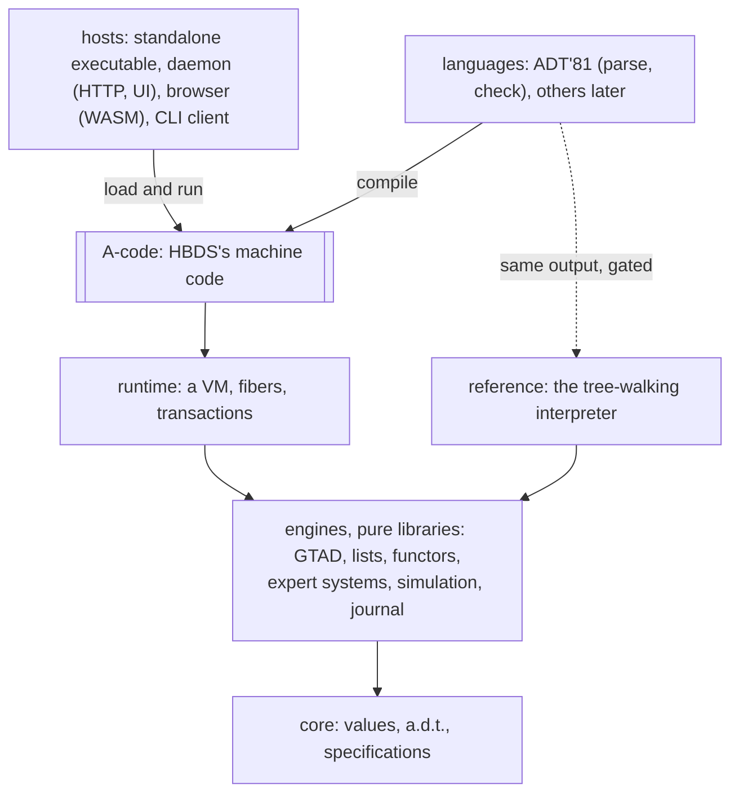
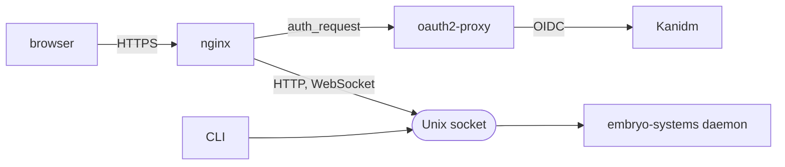

# Architecture

How embryo-systems runs, as opposed to what it runs: the layers, what
each owns, and the decisions that shape them. [adt81.md](adt81.md) is the
language and [hbds.md](hbds.md) the engines; this page is how they are
put to work. Decided on 2026-10-15, point by point; a change to any of it
is recorded here, with its date.

## Why

Today `embryo-systems run` parses a file, replays the journal, walks the
syntax tree and exits: one program, one process. HBDS is meant to be two
things at once, and the print is both:

- **A long-lived system**, a kernel that clients connect to and a UI
  watches. The print's ADTM is "the kernel of the HBDS system" (page
  126), its processes "all implicitly persistent" (page 112).
- **A compiler whose product runs on its own**, carrying what it needs.
  The print compiles ADT'81 to an intermediate *A-code*, with translators
  from A-code to C, Ada, Pascal and Fortran (page 161).

## The layers

- **Engines are libraries.** No I/O, no threads, no language inside: they
  decide what happens, and when code must run (a COND, a rule's premises,
  a process's body) they ask the runtime through a trait, as the expert
  systems and the simulation already do.
- **A-code is the hinge.** Languages compile to it; the runtime, the
  daemon, standalone executables and the browser see nothing else.
- **Hosts are thin.** Each supplies a store (its own or shared), I/O, a
  time source and a way in.

## Decisions

### 1. A-code is HBDS's machine code, shared by every language

Generic computation (arithmetic, control, calls, frames, suspension) and
HBDS's operations (create, set, assert, apply a functor, transactions,
HOLD, CHAV...), on `hbds-core`'s values. ADT'81 compiles to it, as page
161's does, and so would later languages: a modern ADT'81 for now, other
kinds unknown, so it is sized for ADT'81-like semantics, and versioned to
grow. A store keeps compiled modules, so that code from several languages
mixes.

Not chosen: a code of ADT'81's own (a runtime per language); WebAssembly
as the target (no standard way yet to save a suspended stack, HBDS's
values rebuilt inside it, a large dependency). WebAssembly stays possible
as an *output* of A-code, as page 161 translates A-code to C.

### 2. A reference and a fast path; A-code is stack bytecode

The aim is twofold: show that Bouillé's design works, and that it is
fast, which is part of the same claim: millions of facts without pattern
matching (page 80), a sequencing set "of very large size" (page 112), "an
unlimited set of persistent abstract data types" (page 126).

- **The reference** is the tree-walking interpreter: readable, close to
  the print, every decision cited; the executable specification.
- **The fast path** is a VM on **stack bytecode**: flat instructions, an
  operand stack, frames. A paused process is plain data, a pc (page 112's
  LSC, literally), its locals and its stack: saveable, resumable, no
  thread.
- **The gate:** the VM gives exactly the reference's output on every
  golden program and thousands of random ones, as the Rust parser is
  gated against Lark.
- **A text form from the start**, an assembler and a disassembler
  (`embryo-systems acode FILE`): golden tests of the compiler's output,
  the daemon's loaded code readable, and what ADT'81 becomes, shown.
- **Faster tiers only if benchmarks ask:** register bytecode inside the
  VM, invisible above it; native code through translators from A-code
  (page 161).

Not chosen: a tree IR (a paused body would live in Rust's call stack,
threads would stay); register bytecode now (a harder compiler, speed not
the constraint).

As built (2026-10-15, step 4a): `crates/hbds-acode` is the format, its
text form under an `acode 1` header (`embryo-systems acode FILE`), and
`Support`, what a unit asks of its language: its math functions and how
it reads input. Each instruction fails at one place at most, so that the
line table alone gives a runtime error its position. `crates/hbds-vm` runs
one fiber, frames and operand stack as data, OUT and INOUT as references
to the caller's slots. `crates/adt81/src/compile.rs` compiles what needs
no store; the rest is refused as not yet (`run --vm FILE`). The gate,
`tests/vm.rs`: the 20 corpus programs the compiler takes, and 2000 random
programs of `sample::runnable`, of which about 1300 check, run by both
under a statement budget, output, end and statements counted equal;
four planted bugs fail it. On the benchmarks the VM is no faster yet
(`language` 1.59 s against 1.57 s for a million iterations here): the
time is in hbds-values' arithmetic, which both share, not in walking
the tree. Fast paths for exact numbers are the lever, later.

As built (2026-10-16, step 4b1): the store's operations are A-code's,
each popping its operands in the reference's order. Code the store keeps
(COND, ACTION, MODIFIABLE) is compiled the first time it runs, by the
unit's language through `hbds_acode::Language`, against the unit's
modules, cached by part and text; the store and the journal keep text
(compiling when stored comes with step 6). It runs nested in the same
fiber, as decision 3 says code an engine calls back does, 64 deep at
most; so the VM, as the reference, runs on a thread with a large stack.
Computed attributes are functions called, THIS their object. The gate
compares the store's dump too: 33 corpus programs run both ways, the
22 left are the expert systems' and the processes'; the random programs
build a schema with CONDs and ACTIONs. The store's work counts are the
same on both engines, and so are the times: the time is the engines'.

As built (2026-10-16, step 4b2): CALL CHAV and HYPOCHAV are A-code's,
the engines hbds-rules' as for the reference; the VM is their host, its
`Language` the unit's language and SES's compiler in one, and
`hbds_rules::Host` lends the engine the store as a boxed `DerefMut`, so
that the VM keeps its `&mut Store`. A rule's parts are compiled as a
COND is, and run nested with the rule state the reference keeps: reads
in PREMISES lower their reliability or ask, YES and NO stamp what they
write, MODIFIABLE holds outside rules only. A part that fails or jumps
out has its open transactions ended, refused, before the engine hears
of it. The gate: 43 corpus programs run both ways, the 13 left are the
processes'; the random programs make rules over their schema.

As built (2026-10-16, step 4d): `run` compiles to A-code and runs on the
VM; `run --reference` runs the interpreter, which stays the VM's
specification and the gate's other half. `tests/cli.rs` checks the
command's wiring, a store kept by one engine read by the other. Step 4
is done but for interned names (decision 11).

### 3. Fibers, and a sequential world with threads around it

Everything that runs as its own flow of control is a **fiber**: the main
program, a coroutine, a process's body, a client's program. A fiber is its
frames (module, pc, locals) and operand stack, as data, not an operating
system thread: a few hundred bytes, saveable, and able to run in a
browser.

- **One executor thread per store** runs its fibers one at a time,
  switching when one pauses. This is HBDS's model, not a limit of 1995:
  the simulation is quasi-parallel, with "the active process" in the
  singular (page 114); COND and ACTION chain within a statement; reflexes
  propagate in the order the sequencing set gives (page 126). True
  parallelism inside one world would break all three.
- **Threads around it:** one executor per store, so stores run in
  parallel; readers (queries, the UI) on snapshots; I/O (journal syncs,
  network, compilation) off the executor; later, if benchmarks ask,
  parallel work inside a pure operation such as a functor over a million
  objects.
- **Several clients writing** take turns on the executor: serializable by
  construction, only who goes first unpredictable.
- **Code an engine calls back runs to completion**: COND, ACTION, a rule's
  parts, computed attributes, ASKABLE, EDITABLE, MODIFIABLE. HOLD,
  PASSIVATE or PAUSE there is an error that says why: the engine's own
  state (CHAV's agenda, the open transaction) lies beneath it, in Rust.
  Checks and reactions are not processes (page 116 lists them apart, and
  only processes and tasks have time); a reaction that needs time
  schedules a process, as page 126's delayed reflexes are "inserted into
  the SQS".
- **An instruction budget in the daemon:** after N instructions the VM
  switches to another client's fiber, between statements only (a
  statement over a limit is refused whole, as CHAV's 10 000 tries), and
  never between the processes of a simulation, whose active process runs
  until it holds, as in SIMULA. An administrator can kill a session.
  Standalone, a loop that never ends is a bug, stopped by Ctrl-C.

Not chosen: fibers on a pool of threads (they would mostly wait on the
store, and runs would no longer be deterministic); engines made
resumable (each a state machine, which no page of the print needs);
cooperative switching only (one loop freezes every client).

As built (2026-10-16, step 4c): the VM's fibers are the main program,
each coroutine RESUME started and each process's body, one exec loop
running whichever is current; RESUME, PAUSE, HOLD, PASSIVATE and a
fiber's end change which, the sequencing set saying who runs after a
hold. A failure or a jump out ends every fiber between it and the code
that ran it, as the reference's threads end. A coroutine's OUT and INOUT
parameters are shared with the caller's variable, which outlives the
caller's frame. The refusal above is in both engines; so is a later
RESUME without arguments, which the checker had refused. The gate runs
all 60 corpus programs both ways, none left; random programs resume a
coroutine and hold among processes. `simulation-vm` does the same work
as the reference in a quarter of the time: a fiber switch, not a thread
handing over by channel.

### 4. Values compute as HBDS says, and A-code carries it

What the front end compiles away does not reach the runtime: control flow
(EXIT n, NEXT, RELOOP, CASE and EACH become jumps), quotes doubled in
strings, names compared case-insensitively. What operations do to values
is HBDS's, since the store keeps fuzzy values, the journal records them
and rules stamp them: fuzzy propagation (pages 152 and 153), widening,
comparisons and the text of values move from
`crates/adt81/src/value.rs` to a shared crate, hbds-values. A-code's add
is HBDS's addition. A language that means otherwise calls functions of its
own support module; ADT'81's math functions, ours and not the print's,
live in such a module.

Not chosen: opcodes tagged by language (all duplicated with the second
language); every operation a call into a language's library (slow, and
nothing shared).

As built (2026-10-15, step 3): `crates/hbds-values`, on hbds-core alone,
with its own `Op` and `Unary`, named for what they compute, and
conversions to SPECIFY's `Base`; ADT'81 maps its operators onto them in
`crates/adt81/src/value.rs`, which keeps `Ask` and the math functions.
`Op` prints as the print writes it, for messages. UNION, INTER and COMPL
stay the list engine's, so that hbds-lists can take SIGMA's addition from
hbds-values without a cycle. Values' text was already hbds-core's.

### 5. Persistence: exact processes, compaction, group commit

- **The world is data, code and the simulation.** A-code modules are
  journalled when loaded. Processes are exactly persistent: a fiber that
  pauses has its new state journalled in the same write as its
  statement's changes, with the sequencing set and the time. After a
  crash every process resumes where it was, and nothing runs twice.
- **Compaction:** now and then the journal is rewritten, atomically, as
  the shortest sequence of changes that rebuilds the current world. One
  format, one replay path.
- **Group commit:** the journal's thread syncs the transactions of a few
  milliseconds together; a client hears "done" only after its sync.
  Today's guarantee, at many statements per sync.

Not chosen: checkpoints of the processes (the data ahead of them after a
crash, statements run twice); processes not persistent (today's rule:
passive, their bodies starting over); a binary snapshot format beside the
journal; a sync per statement, or on a timer that may lose what was
acknowledged.

As built (2026-10-16, step 6b): the journal's version 2 closes each
transaction with a `commit` line, so that a crash in the middle of one
drops it whole; version 1, a line a transaction, is read and rewritten.
`Store::changes()` is the shortest sequence rebuilding a store, ids kept,
tested by replaying it after every corpus program and every hundred
random changes. A daemon's store records to the journal's thread: a kept
transaction is queued, and the thread writes and syncs what has queued
up in one go; `Durable` says how far it has got, and each event to a
client waits for the transactions made before it. The daemon compacts
once the journal is past `--compact-at` lines (10 000) and twice what the
last compaction wrote, looked at after each turn and, idle, every 100 ms
(the journal may still be catching up); the executor hands the thread `changes()` in
the queue's order, so that what follows lands in the new file;
`embryo-systems compact DIR` does it for a store no daemon holds. A write
that fails stops the journal: what follows is refused, and waiting
clients hear why. Not built: a benchmark of the journal, whose syncs
depend on the disk and on timing, which the work and time gates cannot
hold steady; the journal's tests count syncs instead.

As built (2026-10-16, step 6c2): processes are exactly persistent, with a
checkpoint at each pause (decided 2026-10-16). When the kernel dispatches
a process, the journal holds what is recorded, the process's writes and
any client's that commit meanwhile, in the order the store applied
them; at the process's next pause (HOLD, PASSIVATE, TERMINATE, its end,
an error) it writes all of it in one commit with the kernel's fibers
(`Change::Fibers`: frames, stacks, cells, a module named by its unit's
hash and its place there) and the sequencing set (`Change::Sequencing`).
A crash in the middle of a step loses the step whole, which then runs
again from the last pause: nothing runs twice. A client hears nothing
before the write that holds its own; compaction waits while a step is
held. A client's change to the set is kept as it makes it. A restarted
daemon loads its store's units, then the set and the fibers, the
clients' agents dropped: every process resumes where it paused.
`tests/daemon.rs` kills a daemon in the middle of a counting process's
steps and finds, after the restart, its count equal to its clock, and
counting on.

### 6. Time: one sequencing set per store, at a pace set live

- **Standalone programs keep SIMULA's rules:** the main program is a
  process, its HOLD moves time, its end ends the simulation.
- **In the daemon the kernel drives the sequencing set,** the engine that
  "sets itself to the time" of page 114; clients come and go, their
  processes live on.
- **One sequencing set per store**, the print's single one, which the
  reflex engine feeds too (page 126): one world, one time.
- **The pace is the store's**, changed live by a client or the UI, like a
  player: paused or step by step; as fast as possible up to a horizon;
  real time times a factor, the kernel waiting on the clock, for a living
  system (monitoring, reflexes, page 116's real-time tasks).

Not chosen: a sequencing set per client (two times over the same
objects); virtual time only; real time only.

As built (2026-10-16, step 6c1): the daemon's store has one sequencing
set, which a kernel drives: a VM session of its own that runs the
processes due, each until it holds, passivates or ends, as one
participant of the round robin between clients' turns. A client is
outside time until it acts on it (ACTIVATE, REACTIVATE, CANCEL, KILL,
DELAY or HOLD; decided 2026-10-16): from then on it is an agent, the
active one as SIMULA's main program is, and the kernel waits while it
runs; its HOLD puts it in the set until the kernel reaches its time. So
a lone client sees what a standalone run shows (the whole corpus passes
through the daemon), and a client that never touches time stays outside
it. Its processes outlive it: what they print goes to their client while
it is connected, else to the daemon's output; an error ends the process,
and its client's run if it is there. The pace, `paused` (the default),
`step`, `fast` up to a horizon or `real` times a factor, is set by
`daemon --pace` and live by `POST /pace`; `GET /time` shows the time and
who is due. Every unit a client brings is kept by the store, once, by
the hash of its text (`Change::Module`), and loaded into the kernel, its
instructions relocated: a new body serves new activations, a process
already running keeps the one it started in (decision 10); a restarted
daemon loads the units its store kept. Processes do not survive a
restart yet: step 6c2.

### 7. Concurrency: the statement as a transaction, persistent maps

- **A client's unit of work is the statement**, as today and as the
  print: a statement and the COND, ACTION and rules it triggers, kept or
  refused together. A program is not one transaction: across a HOLD it
  would hold the store through time.
- **The store's maps become persistent data structures, written here**:
  versions share what they did not change. Beginning and undoing a
  transaction cost nothing (today every `begin()` copies the whole
  model); a reader takes the current version and reads it on its own
  thread while the executor writes; a write copies one path. A B-tree or
  a HAMT, property-tested against `BTreeMap` and benchmarked.

Not chosen: an ATOMIC block of several statements (syntax the print
lacks, and a long one blocks every client; possible later); a crate at
the heart of the store; today's maps, reads queued on the executor.

As built (2026-10-15, step 2a): `crates/hbds-maps`, a B-tree of 7 to 15
entries a node, chosen over a HAMT because the store's order shows (OBJ
oldest first, CHAV's rules, the dump) and the indexes need ranges. A
write copies only the nodes a snapshot still shares, so a statement that
keeps its changes copies one path. At the top rung of `store`, 4000
objects, the entries copied fall from 16 016 001 to 271 476 and the
time from 3.2 s to 0.9 s here; growth stays x4, the lookups still
scanning. Associations stay a `Vec`, which no benchmark uses.

### 8. The daemon's interface: our HTTP, one Unix socket

- **A minimal HTTP/1.1 and WebSocket server, written here**: plain
  threads, no async runtime, no TLS, no authentication.
- **WebSocket, with JSON frames, for sessions and events** (`run`, `repl`,
  the UI's live feed); plain HTTP for one-off requests (the schema, the
  pace, loading a module).
- **One door, a Unix socket**, guarded by file permissions. The CLI uses
  it directly, and the journal records the Unix user. Browsers come
  through nginx, which terminates HTTPS, upgrades WebSockets and proxies
  to the socket, authenticating by `auth_request` to oauth2-proxy against
  Kanidm and passing the user in a header the journal records. The daemon
  serves the UI's files, embedded in its binary.

Not chosen: hyper or axum on tokio (an async runtime the single executor
does not need); HTTP alone (a conversation split in two); a TCP port as
well (two doors). Who may change which a.d.t. is for later, near NINJAS
(project 20).

As built (2026-10-16, step 6a): `crates/hbds-http` is the wire, HTTP/1.1,
the WebSocket upgrade with its SHA-1 and base64, and JSON, tested on the
RFCs' examples; `crates/hbds-daemon` the daemon, `embryo-systems daemon
--socket SOCKET [--store DIR] [--slice N]`. One executor thread owns the
store; a session is a client's program, a VM `Session` that runs in
turns of N instructions, round robin, ending only between statements
outside any callback and transaction, or where READ waits for a line
(decision 3). A READ inside code the store calls back cannot end a turn,
so the executor waits on that client: rare (an ASKABLE fact), and the
price of callbacks running to completion. `run`, `exec` and a built
program take `--connect SOCKET`. `GET /store` and `GET /sessions` answer
plain HTTP. Still as before until 6b and 6c: a sync per statement, and a
sequencing set per session. `tests/daemon.rs` runs the whole corpus as
sessions, two at once, and a client that leaves; `tests/vm.rs` runs it
in turns of five instructions too.

As built (2026-10-16, step 6d): `GET /events` is the feed, a WebSocket
the daemon only writes to, each frame once what came before it is on
disk: the store's changes as the journal writes them (a module by its
hash, the kernel's saved state left out), sessions starting and ending,
the time as each kernel turn leaves it, the pace when it changes, and
what a process prints with no client to print to. `GET /sessions` lists
the sessions; `POST /sessions/ID/kill` ends one, its client told so, its
processes kept (decision 3's administrator). `nix/module.nix`, the
flake's `nixosModules.default`, runs the daemon as a service: its own
user, the store in `/var/lib/embryo-systems`, the socket in
`/run/embryo-systems` and the group's alone (`UMask=0007`), the pace and
the rest as options, sandboxed; `just module` evaluates a system with it
enabled and checks its unit. nginx, oauth2-proxy and Kanidm before it
are the host's to configure, as above. Step 6 is done.

As built (2026-10-16, step 7a): the UI is plain HTML, JS and CSS (decided
2026-10-16: no framework, no build), `crates/hbds-daemon/ui/`, embedded
with `include_str!` and served at `/`. It opens the feed and fetches
where things stand: the schema (`GET /schema`, classes with their
attributes, hyperclasses and objects' count, the links between them,
fetched again as changes come), the time as a timeline of who is due
and the processes' states and clocks (`GET /time`), the sessions with a
kill button, the journal's tail, and the pace, which it sets. A browser
reaches no Unix socket: `embryo-systems ui --connect SOCKET` listens on
127.0.0.1 only and forwards to the socket as the user running it, the
daemon keeping its one door; behind nginx the page is the socket's `/`.
No browser runs in CI: `tests/daemon.rs` checks what the page reads, and
the page itself was run by hand. 7b, the acting side (a REPL, rules
firing in the feed), follows.

As built (2026-10-16, step 7b): the page's REPL sends an entry as
`{"source": TEXT}` on a session's WebSocket; the daemon's language
compiles it as a fragment (the `REPL` part, statements as an ACTION's)
and runs it as a client's session, in turns and in time as any. Each
entry its own run (decided 2026-10-16): the store keeps what it did, its
variables go with it. A fragment's local variables now take their
initial value and constant in both engines, as a module's do (the
reference had dropped them; `store/locals.adt`). CHAV and HYPOCHAV
report the rules they tried and those that fired (`Io::rules`), which
the feed carries as `{"rules": ...}`, said of the session or the process
that ran them, and the page shows. Step 7 is done.

Since (2026-11-14): an entry that asks for a line (READ, a dialog's
question) gets a field under it, its line sent as `{"input": LINE}`,
"end input" as `{"eof": true}`; it had its input ended at once. The
page's dialogs start that way (docs/hbds.md, "Dialog").

### 9. Standalone builds carry what they need

- **Two products:** an `.acode` file, portable compiled modules (for
  `embryo-systems exec`, the daemon, the playground); and a
  **self-contained executable**, `embryo-systems build prog.adt -o prog`:
  the prebuilt runtime with the A-code appended and a trailer saying
  where it starts. No toolchain at build time, milliseconds to build, and
  it runs on any machine of its platform. Native code through page 161's
  translators comes later, if benchmarks ask.
- **Every engine, always**: one runtime per platform, a few megabytes,
  and A-code can count on every operation.
- **Embedded or connected**, chosen when it starts: its own store, in
  memory or `--store DIR`; or `--connect SOCKET`, its A-code sent to a
  daemon and run there as a session.
- **Platforms:** runtimes for x86_64 and aarch64 Linux and for WASM, built
  by the flake; `build --target` appends to the right one.

Not chosen: `.acode` alone (needs embryo-systems installed); native code
first; only the engines a program uses (a runtime per combination).

As built (2026-10-16, step 5): the runtime is embryo-systems' own
binary, which the VM needs whole anyway, its language compiling the code
a store keeps. `build FILE -o OUT` writes that binary, the A-code's text,
its length and a magic; a binary that ends so runs what it carries,
`OUT [--store DIR]`, and is not the command. An `.acode` file is the
text form, `acode 1`, which now names its language; `exec [--store DIR]
FILE` runs one, refusing a newer version or a language it does not have.
Embedded only: `--connect` waits for the daemon, and other platforms
(`build --target`, aarch64, WASM) for runtimes the flake builds.
`tests/cli.rs` runs what `acode` writes and what `build` writes, copied
elsewhere.

### 10. Versions: read older, refuse newer; modules side by side

- **Every format carries its version**: the journal, A-code, saved
  fibers. A reader converts older versions as it loads them and
  compaction rewrites them in the current one; a newer one is refused,
  saying so. Every old version stays as a test fixture.
- **A loaded module never changes**: it is named by a hash of its content,
  and loading a new body adds a version, as Erlang does. Paused fibers
  finish in the version they started in, new activations get the newest,
  and an old version goes once no fiber uses it.

Not chosen: the exact version only, with a converter; refusing to load a
module in use; restarting its fibers in the new version, their place and
locals lost.

### 11. Engine performance

- **GTAD gets indexes, early**: name to class, class and name to object,
  class to objects, object to its outgoing and incoming links, hyperclass
  to members, attribute name to class attributes. Lookups and functors
  scan today, which a million objects would not survive. Persistent maps
  too, rebuilt on replay, not journalled.
- **Names are interned**: each folded name is kept once and numbered,
  compared as an integer, its spelling kept for display; A-code carries
  the numbers.
- **Large values are shared**: lists, arrays and strings behind a
  reference count, copied only when one that is shared changes.

As built (2026-10-15, step 2b): the indexes are `PMap`s inside the
store, in its snapshots, kept by `apply` and `purge` alone through one
put and one drop per kind of entry, so a replay rebuilds them. Beside
decision 11's list, the class links by end (PSC, NSC) and the object
links by class link (EFF). The model's maps are read-only outside GTAD.
`Store::verify` rebuilds every index and checks that nothing dangles;
the corpus and the store tests call it after each program, and a random
test after each of 3000 changes. Every scenario but `chav` is linear now:
store 4000 in 71 ms here, from 916. `chav` stays near x3 because CHAV's
`pick` reads every rule's PRIORITY for each try, n squared lookups: the
engine's, not the store's, left for later.

Changed (2026-10-15): interned names move from step 2 to step 4. A
profile at four times the top rungs found folding and comparing names
at about 2% of the time, and a lookup still arrives as a string, to fold
and hash before any number helps; once A-code carries the numbers, it
pays. What the profile found instead, each n squared on one statement,
so that the ladder hid it: the functors' union of results, a `contains`
on a `Vec` for each result (a quarter of the time on `"town" ' obj '
card` over 16 000 objects), now beside a set; and CHAV, whose agenda is
now ordered by priority, each read when a rule goes on it and read again
after a try that may change it, with the rules consuming each fact
indexed, so `react` no longer walks every rule. `chav` 1000 rules:
176 ms to 77, lookups 1 043 051 to 44 051; every scenario linear.

Changed (2026-10-16): interned names wait for a profile that asks for
them. With the VM built, they are a constant factor across GTAD, A-code
and the VM, about 2% when last measured; A-code is versioned, so carrying
numbers later is a new version of the format, not a migration.

As built (2026-10-15, step 2d): strings are `Arc<str>`, lists' items
and arrays' cells `Arc<Vec<Value>>`, changed through `Arc::make_mut`,
so a copy costs a count and a list changes in place unless another
value shares it, as `M := L` then `EXTRACT ... OUTOF L` checks (the
corpus's lists.adt). A scenario of its own, `values`, assigns a list of
n integers n times: before, x3.9 per doubling, 1.26 s at 8000 here; now
linear, 15 ms at 8000, 0.46 s at 256 000, where the ladder now stands.
The harness now discards a first run and keeps the median of five: the
simulation, a thread per process, moved 17% between two runs a minute
apart, its first run the slowest.

### 12. Benchmarks at the print's scale

- **Scenarios**: the store and functors (a million objects, lookups,
  functor chains such as page 127's over a large graph, SIGMA); the
  expert system (CHAV, ten thousand rules over a hundred thousand facts,
  page 80); the simulation (a hundred thousand processes, a million
  events); the language (the reference against the VM); later the daemon
  (statements per second, journal throughput). Every new engine brings
  its own, reflexes next: a convention arrives with its gate.
- **They gate**, on the Forgejo runner, our own hardware: results are
  versioned in the repository, and CI fails past a margin (15%); a
  speed-up is recorded on purpose.
- **Our own small harness**, `just bench`: the median of a few runs, plain
  text, and the work done counted (instructions, store operations) beside
  the wall time, so that a regression says why.

Not chosen: numbers tracked but never gating; benchmarks run by hand;
criterion (a dependency, wall time only).

As built (2026-10-15, step 1): the scenarios are ADT'81 programs in
`bench/scenarios/`, their sizes, names and rule code on stdin (the
language has no integer-to-string conversion), so step 4 runs the same
ones through the VM. Each runs on a ladder of four doubling sizes, the
growth from one to the next printed: today x4 everywhere but the
language, since every statement's transaction copies the whole model and
every lookup scans. The work counted is the statements executed, and the
store's changes, lookups, items scanned and items its snapshots copied.
The work is the same on every host and gates exactly, on every host,
against `bench/work.txt`: an extra lookup per CREATE, planted, scanned a
third more and cost only 7% of the time, under the margin. Times are per
host, `bench/<hostname>.txt`, wall time meaning nothing across machines;
the runner's file is the gate, and a host without one only prints them.
Times under 100 ms are not gated, noise being most of them. `just
bench-record` writes the work and this host's times; the runner's times
are copied from what its CI run prints.

### 13. No SFSI and ZE: the journal is the persistence

Decided on 2026-11-14. Project 13 (pages 86 to 105) is not rebuilt. The
print specifies SFSI, its indexed-sequential file system, down to the
byte: the FET, the FIT and the index blocks field by field, 2 KB
granules, 96 files a user, six passwords a file, pools of buffers, a
DAYFILE fed through two alternating buffers; and ZE, the exchange zone
(page 103), a write-through cache of the persistent a.d.t. between GTAD
and SFSI, circular buffers behind SAVE, LOAD and RESTORE.

- **No program would see it.** Every other engine adds to what ADT'81
  says; SFSI and ZE change only how bytes reach the disk. The corpus
  would print the same.
- **What it does is done.** The journal (decision 5) is the DAYFILE:
  history, replay after a crash, compaction; GTAD's persistent maps
  and transactions (decision 7) are what ZE's cache was for.
- **Its design answers 1995's machines**: fixed buffers and granules
  sized for a micro's memory. Rebuilt faithfully, it would emulate those
  limits, not carry an idea.
- **It would cost the most** of what is left, in the one place a mistake
  loses data.

What SFSI and ZE gave GTAD that we lack is a store larger than memory,
its a.d.t. loaded on demand. Nothing asks for it; if a store outgrows
memory, it comes as another `Recorder`, designed for its time, behind
the interface `crates/hbds-journal` already implements.

## The order

Each step is a plan and a pull request of its own:

0. This page; then a lock on a store's directory, so that two runs can no
   longer write one journal.
1. Benchmarks: the harness and a baseline, before anything is optimized.
2. The store: persistent maps, indexes, shared values; measured against
   the baseline.
3. hbds-values: the semantics of values out of adt81.
4. A-code and the VM: the format, versioned, with its text form; the
   compiler from the typed tree; fibers, processes and coroutines leaving
   threads; interned names, which A-code carries; the gate against the
   reference.
5. Builds: `.acode`, `exec`, self-contained executables, embedded or
   connected.
6. The daemon: the executor, the journal's thread, group commit,
   compaction; modules and fibers journalled, their versions; the pace;
   the HTTP and WebSocket server; the CLI as a client, events, the
   instruction budget; a NixOS module.
7. The UI: the schema, the sequencing set as a timeline, rules firing,
   the journal's tail, a REPL.

The print's engines (reflexes, neurons, constraints, dialog) are libraries, and
come between any two steps; reflexes read most naturally after the
daemon, inside the kernel where page 126 puts them.
