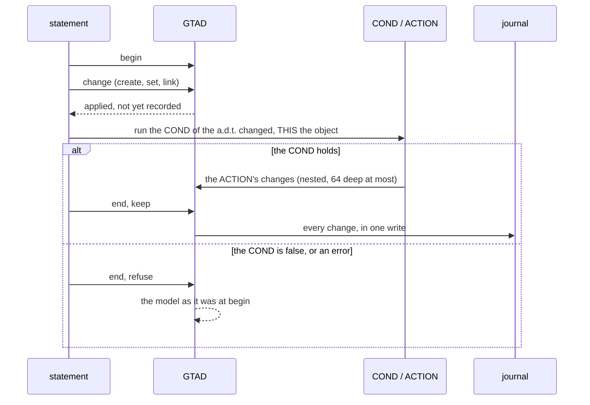
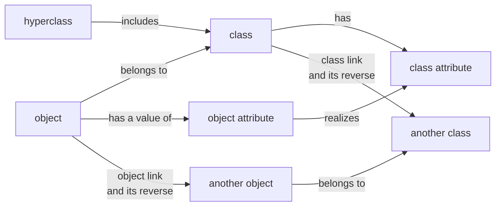

# The HBDS engines

What ADT'81 programs create and query: classes, their attributes and
links, objects, their values and links, and the engines that keep and
query them. The print builds the store in three layers:

- **GTAD**, the a.d.t. engine, in memory (pages 45 to 48);
- **ZE**, the exchange zone, a write-through cache of the persistent a.d.t.
  (page 103);
- **SFSI**, an indexed-sequential file system, with its catalogue,
  granules, index blocks and DAYFILE journal (pages 86 to 102).

`crates/hbds-gtad` is the first layer, made durable by a journal in the
DAYFILE's spirit (`crates/hbds-journal`). A faithful SFSI and ZE are a
project of their own, as they are in the print (project 13); they can
come later behind the same interface.

## Engines and languages

The print builds HBDS as engines (*moteurs*), each a project of its own,
for a team of its own: GTAD (project 12), SFSI and ZE (13), the list
engine (14), the functor engine (15), the expert systems (16), the
simulation (17), the neurons (18), the dialog (19). So does this
repository: each engine is a crate, as independent as it can be, and a
language is a crate that uses them. Decided on 2026-10-15.

| crate | what | depends on |
|---|---|---|
| `hbds-core` | the shared vocabulary: values (numbers of every kind, fuzziness, lists, arrays, a.d.t.), a.d.t. references, types and kinds, specifications, functor signatures; data, no logic | nothing |
| `hbds-lists` | the list engine (project 14, page 80): cursors, circular lists, the list functors, union, intersection, complement | core |
| `hbds-gtad` | the a.d.t. engine (project 12): the model, its changes, lookups, states; persistence behind its `Recorder` trait | core |
| `hbds-functors` | the functor engine (project 15): the catalogue on a.d.t. and its implementation on GTAD | core, gtad |
| `hbds-journal` | GTAD's persistence, a `Recorder`: the journal below; SFSI and ZE would be another | core, gtad |
| `adt81` | the first language: grammar, parser, checker, interpreter, and what is the language's own (arithmetic and fuzzy propagation, math functions, what an unknown name means); it wires the engines together | the engines |
| `embryo-systems` | the command; picks the language by the file's extension, `.adt` for ADT'81 | adt81, gtad, journal |

The rules: an engine depends on the core and on as few engines as it
needs, never on a language; a language never on another language.
`tools/check_engines.py`, run by `just check`, holds what each crate may
use, and fails on anything else, or on a crate it does not list.

The code an a.d.t. carries (COND, ACTION) is stored with the name of the
language it is written in, `ADT'81` for ours, so that a store may hold
the code of several, and each runs its own. Journals written before
2026-10-15 do not open: a property record gained its language.

## Decisions

Taken on 2026-10-15:

- **Storage: the model in memory, a journal on disk.** Every change is one
  record, appended to `DIR/journal` and synced before the statement that
  made it goes on, as ZE forces its writes (page 103). Opening a store
  replays its journal through the same code that recorded it. A last line
  cut short by a crash is dropped, with a warning; a corrupt line elsewhere
  stops the opening, naming the line. Compaction is for later.
- **Lifetime: `run FILE` uses a store that lasts the run; `run --store DIR
  FILE` opens, or creates, a persistent one**, so that what a program
  builds is there for the next. `embryo-systems store DIR` prints what a
  store holds.
- **A.d.t. names compare case-insensitively** (decided on the same day):
  classes, objects, attributes and link relationships are kept as written
  and found folded, `"arc"` and `"ARC"` being one class. The polycopié's
  code needs it: page 127 reaches arcs by `OPSCRC("direct", "arc")` and
  computes their length in `FUNCTION "ARC" . "LENGTH"`, page 128 reads
  `p . "y"` beside `p . "X"` and declares `LA` beside `la`. It is the
  language's rule for names, carried over to the store.
- **COND and ACTION run on change**; see below.

## COND and ACTION

An a.d.t. may carry a COND, a boolean expression, and an ACTION, a list of
statements, both strings (pages 156 to 158): "each time the a.d.t. is
invoked, the associated condition is implicitly tested", and the action
"is executed only if the condition is verified". Decided on 2026-10-15:

- **Invoked means changed.** Three changes run them: creating an object
  runs its class's; setting an attribute's value runs the class
  attribute's; asserting a link between objects runs the class link's
  (page 158: "tested any time a new link between objects will be
  instantiated"). Then the object's own. THIS is the object concerned:
  the one created, whose attribute is set, from which the link goes.
  Reading runs nothing.
- **A false COND refuses the change**, as page 158's constraints read (a
  temperature above zero, at most six neighbors): the statement fails
  with a runtime error naming the COND, and the store is as it was before
  it. Its ACTION does not run (page 157).
- **A statement is a transaction.** Its changes, and those of the
  ACTIONs they run, are kept together or refused together: GTAD applies
  them at once, records them only when the statement succeeds, in one
  write, and otherwise puts the model back. A refused change never
  reaches the journal.
- **An ACTION's own changes run CONDs and ACTIONs in turn**, 64 deep at
  most; past that, an error.
- **Code runs in its language.** COND and ACTION are stored with the
  language they are written in; ADT'81 runs its own, and says so of any
  other.

A statement that changes the store runs as one transaction:



A COND names an attribute with a quote written twice inside its string,
`"THIS . ""temp"" > 0."`; page 158's own `THIS."temp" > 0. "` is not one
string ([adt81.md](adt81.md), "Decisions").

## The model

The six basic a.d.t. (page 46, figure 6), as the store keeps them: a
class carries attributes and links to other classes; an object belongs to
a class, carries values for its class's attributes, and links realizing
its class's links. Every link has its reverse.



- **Classes** are named by strings. An object is named within its class,
  `"Paris" [ "TOWN" ]`. A class is a class, an embryo (DESIGN), a
  prototype (`COMPOSE p WITH embryos`) or a structure (`BUILD s AS p`).
- **Links between classes** come in pairs: creating `"RIVER" "crosses"
  "TOWN"` creates the reverse link at once, named by REVERSE or unnamed
  ("the system immediately creates the reverse link, which will receive
  the reverse relationship, either immediately if given by the user, or
  later, or even never", page 74). A REFLEXIVE link is its own reverse:
  `"neighbor"` both ways.
- **Links between objects** realize a link of their classes: ASSERT makes
  one, with its probability if `%` gives one, and its reverse with it;
  `ASSERT ... NOT` removes it. `a "r" b` in an expression tells whether
  the link is there.
- **Attributes** are created on classes; objects carry their values (LET
  sets one). An attribute specified COMPUTED, or with a `FUNCTION "CLASS" .
  "ATTRIBUTE"` in the program, is computed when read, by that function,
  THIS being the object (pages 127 and 128).
- **States**: HIBERN and AWAKE, DESTROY and RESUR, and PURGE, which removes
  a destroyed a.d.t. for good, with what depends on it. A hibernating or
  destroyed a.d.t. is invisible to the functors and to lookup by name, and
  so is what depends on it: an object of a hibernating class, a link to a
  destroyed object.
- **Hyperclasses**: INCLUDE puts classes in a hyperclass, EXCLUDE takes
  them out; CONT and CONTOF go down and up.
- **Associations** (ASSOC, DISSOC, page 24, figure 9) are kept as pairs;
  no functor reads them yet.
- **Functors**: all those of the catalogue (pages 76 to 80) on the model,
  each applied to an a.d.t. or to a list of them, the results united in
  order without repeats. SIGMA adds the values of the attributes in a list
  (page 78).

## The journal

One change per line, as terms: words, numbers, quoted strings (`\"`,
`\\`, `\n` escaped), and parenthesised lists.

```
class 1 "TOWN" class
attribute 3 1 "INHABITANTS"
classlink 5 6 2 "crosses" 1 "crossed by"
object 7 1 "Lyon"
set 7 3 (i 522000)
set 7 4 (fz (f 284.5) 0.5 - -)
objectlink 9 10 5 8 7 0.9
specify (ca 4) "FLOAT APPR" "kelvin" false
property (ca 4) "COND" "ADT'81" "THIS . \"TEMP\" > 0."
state (o 8) destroyed
```

Values: `(i n)`, `(r n d)`, `(f x)`, `(g a b)`, `(x re im)`, `(q r i j k)`,
`(b true)`, `(ch "c")`, `(s "text")`; a fuzzy one `(fz value appr prob
subj)`, `-` for what it lacks; `(many ...)`, `(list cursor circular
...)`, `(array rank (lows) (dims) ...)`, `(adt (o 7))`.

## Open questions

- **What BUILD instantiates.** A prototype is made of embryos (figure 8),
  and "the prototype network has more than 50 structures instantiated";
  whether building one copies the embryos' attributes and links, and how
  the structure's classes are named, the print does not say. BUILD records
  the structure and its prototype.
- **What a class inherits from its hyperclass.** Page 159 has "all
  classes included in" the hyperclass CONSTRAINT "inherit of the FORMULA",
  its attribute. INCLUDE records the inclusion; nothing is inherited yet.
- **What associations are for.** ASSOC and DISSOC keep their pairs (page
  24, figure 9's multi-layer system), but no functor reads them yet.
- Processes (ACTIVATE...) belong to the simulation engine (page 112).

## Files

| path | what |
|---|---|
| `crates/hbds-gtad` | the model, its changes, lookups |
| `crates/hbds-functors`, `crates/hbds-lists` | the functors on a.d.t., and the list engine |
| `crates/hbds-core` | values, specifications, the vocabulary |
| `crates/hbds-journal` | the journal's format, recording and replay |
| `tools/check_engines.py` | what each crate may depend on |
| `crates/adt81/src/interp.rs` | the a.d.t. statements and expressions, on the store |
| `crates/adt81/tests/corpus/run/store/` | programs on the store, with their expected output |
| `crates/adt81/tests/store.rs` | the store across runs, a torn journal, a corrupt one, a refused change, code in another language |
