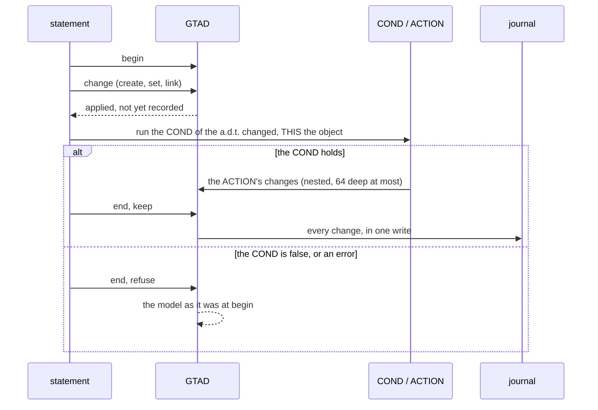
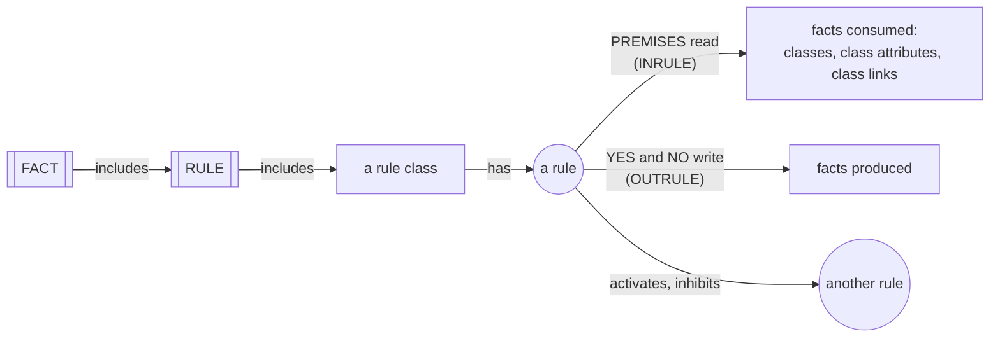
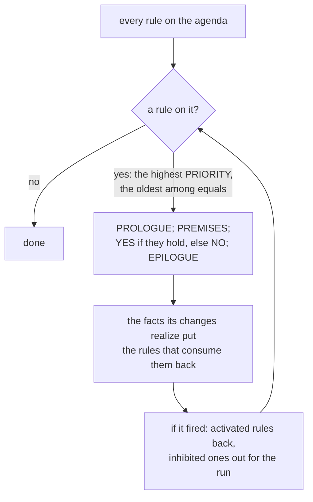
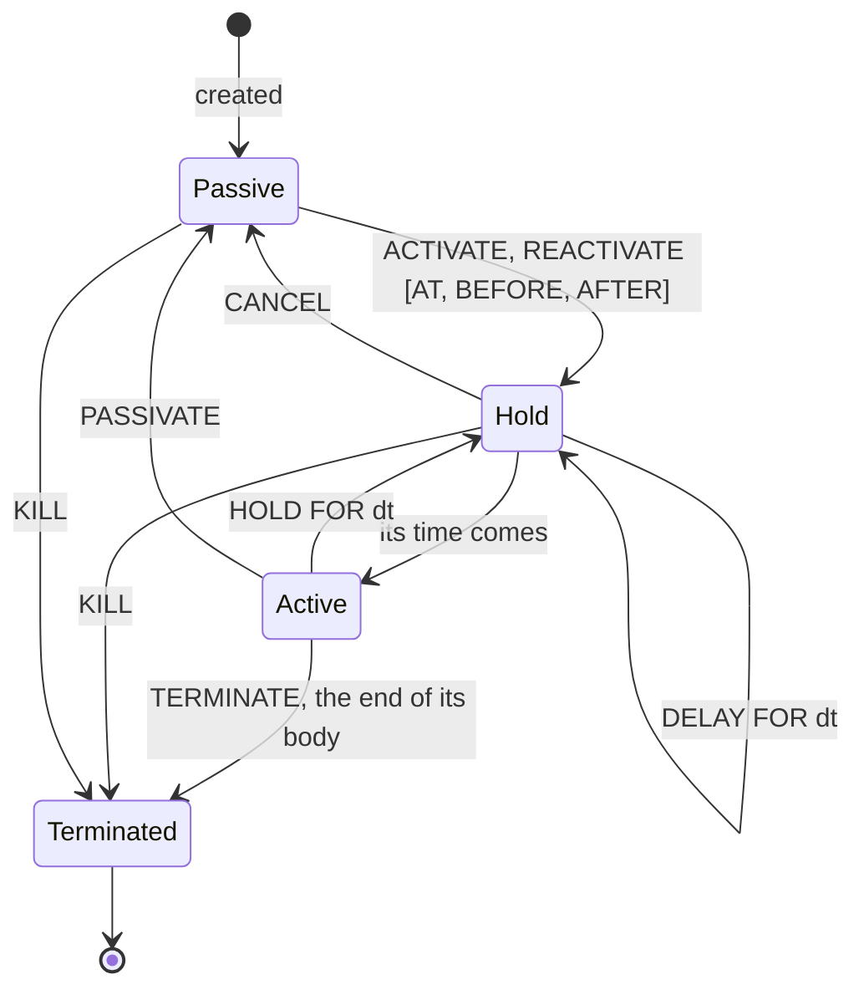
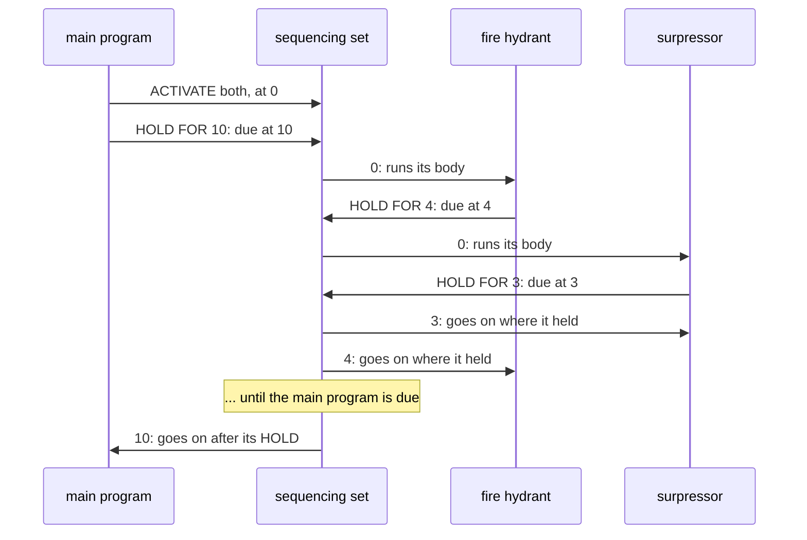
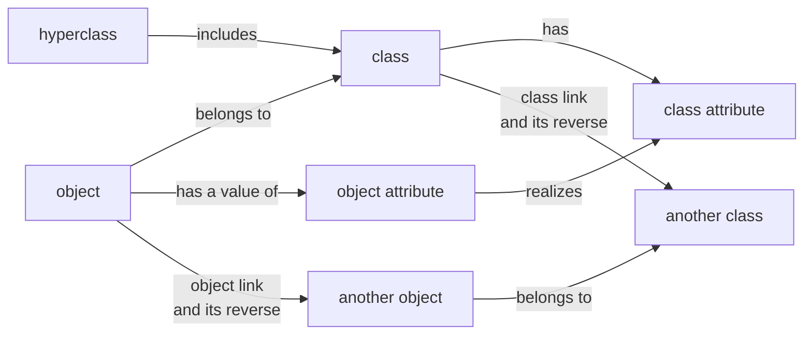

# The HBDS engines

What ADT'81 programs create and query: classes, their attributes and
links, objects, their values and links, and the engines that keep and
query them. The print builds the store in three layers:

- **GTAD**, the a.d.t. engine, in memory (pages 45 to 48);
- **ZE**, the exchange zone, a write-through cache of the persistent a.d.t.
  (page 103);
- **SFSI**, an indexed-sequential file system, with its catalogue,
  granules, index blocks and DAYFILE journal (pages 86 to 102).

`crates/hbds-gtad` is the first layer, made durable by a journal in the
DAYFILE's spirit (`crates/hbds-journal`). SFSI and ZE are not rebuilt:
[architecture.md](architecture.md), decision 13, says why; a store larger
than memory would come behind the same interface.

## Engines and languages

The print builds HBDS as engines (*moteurs*), each a project of its own,
for a team of its own: GTAD (project 12), SFSI and ZE (13), the list
engine (14), the functor engine (15), the expert systems (16), the
simulation (17), the neurons (18), the dialog (19). So does this
repository: each engine is a crate, as independent as it can be, and a
language is a crate that uses them. Decided on 2026-10-15.

| crate | what | depends on |
|---|---|---|
| `hbds-core` | the shared vocabulary: values (numbers of every kind, fuzziness, lists, arrays, a.d.t.), a.d.t. references, types and kinds, specifications, functor signatures; data, no logic | nothing |
| `hbds-values` | what operations do to values, whatever the language: every number type and the widening between them, comparisons, text, arrays (page 153), fuzziness propagated (pages 152, 153); `Op`, the operations a language maps its operators onto | core |
| `hbds-lists` | the list engine (project 14, page 80): cursors, circular lists, the list functors, union, intersection, complement; SIGMA adds as hbds-values does | core, values |
| `hbds-maps` | the persistent ordered map the store keeps its model in: a B-tree whose versions share nodes, so a transaction's snapshot costs nothing | nothing |
| `hbds-gtad` | the a.d.t. engine (project 12): the model, its changes, its indexes and lookups, states; persistence behind its `Recorder` trait | core, maps |
| `hbds-functors` | the functor engine (project 15): the catalogue on a.d.t. and its implementation on GTAD | core, gtad |
| `hbds-journal` | GTAD's persistence, a `Recorder`: the journal below, in place of SFSI and ZE (architecture.md, decision 13) | core, gtad |
| `hbds-simulation` | the discrete simulation (project 17): PROCESS, the sequencing set and figure 52's transitions; a language runs the bodies | core, gtad |
| `hbds-rules` | the expert systems (project 16): rules and facts, SES's functors, CHAV and HYPOCHAV; a language runs the rules' code behind its `Host` trait | core, gtad |
| `hbds-reflexes` | the reflex engine (project 18): REFLEX, what each change launches; a language runs the reactions | core, gtad |
| `hbds-neurons` | the neural engine (project 18): NEURON, a stimulus stored or ignored, a firing's input; a language runs the reactions and LEARNING | core, gtad, reflexes |
| `hbds-constraints` | the constraint engine (pages 157 to 160): CONSTRAINT, the constraints each change concerns; a language runs the FORMULAs | core, gtad |
| `hbds-dialog` | the dialog engine (project 19): figure 71's Q-Graph, a run's steps; a language runs the tasks behind its `Host` trait | core, gtad |
| `adt81` | the first language: grammar, parser, checker, interpreter, and what is the language's own (its operators mapped onto HBDS's operations, math functions, what an unknown name means); it wires the engines together | the engines |
| `hbds-acode` | A-code, HBDS's machine code: the format, its version, its text form, and what a unit asks of its language | core, values |
| `hbds-vm` | the VM that runs A-code: fibers, their frames and operand stacks as data, the store's operations, code the store keeps compiled when it runs | core, values, lists, acode, gtad, functors, rules, simulation, reflexes, constraints, dialog, neurons |
| `hbds-http` | the daemon's wire: HTTP/1.1, WebSocket, JSON | core |
| `hbds-daemon` | the daemon: the executor owning the store, clients' sessions in turns over a Unix socket, and the client side; no language of its own | core, acode, gtad, http, journal, vm |
| `embryo-systems` | the command; picks the language by the file's extension, `.adt` for ADT'81 | adt81, gtad, journal, acode, vm, daemon |
| `embryo-systems-bench` | the benchmarks, `just bench`: the programs of `bench/scenarios` on a ladder of sizes, by the reference and the VM, against `bench/work.txt` and `bench/<host>.txt` | adt81, gtad, vm |

The rules: an engine depends on the core and on as few engines as it
needs, never on a language; a language never on another language.
`tools/check_engines.py`, run by `just check`, holds what each crate may
use, and fails on anything else, or on a crate it does not list.

The code an a.d.t. carries (COND, ACTION) is stored with the name of the
language it is written in, `ADT'81` for ours, so that a store may hold
the code of several, and each runs its own. Journals written before
2026-10-15 do not open: a property record gained its language.

## Decisions

Taken on 2026-10-15:

- **Storage: the model in memory, a journal on disk.** Every change is one
  record, appended to `DIR/journal` and synced before the statement that
  made it goes on, as ZE forces its writes (page 103). Opening a store
  replays its journal through the same code that recorded it. A last line
  cut short by a crash is dropped, with a warning; a corrupt line elsewhere
  stops the opening, naming the line. Since 2026-10-16 (version 2 of the
  journal) each transaction ends with a `commit` line, and one a crash
  left without it is dropped whole; in the daemon a thread of its own
  syncs what queues up together, and the journal is compacted, rewritten
  as the shortest one rebuilding the store (`embryo-systems compact DIR`).
- **One opening at a time.** An open store holds a lock on `DIR/lock`, so
  a second run, or `store DIR`, on it is refused instead of writing the
  same journal. The system releases the lock when the process ends, even
  in a crash, so there is no stale lock to clear. The lock is a file of
  its own because compaction will replace the journal with a new file.
- **Lifetime: `run FILE` uses a store that lasts the run; `run --store DIR
  FILE` opens, or creates, a persistent one**, so that what a program
  builds is there for the next. `embryo-systems store DIR` prints what a
  store holds.
- **A.d.t. names compare case-insensitively** (decided on the same day):
  classes, objects, attributes and link relationships are kept as written
  and found folded, `"arc"` and `"ARC"` being one class. The polycopié's
  code needs it: page 127 reaches arcs by `OPSCRC("direct", "arc")` and
  computes their length in `FUNCTION "ARC" . "LENGTH"`, page 128 reads
  `p . "y"` beside `p . "X"` and declares `LA` beside `la`. It is the
  language's rule for names, carried over to the store.
- **COND and ACTION run on change**; see below.
- **Setting a value to the one it has changes nothing**, and records
  nothing; its COND and ACTION still run.

## Inheritance

A class inherits the attributes and the class links of the hyperclasses
that include it, and of theirs, at any depth (decided on 2026-10-15):
figure 46 has every rule class "inheriting the components" of the
hyperclass RULE, and page 159 every class included in CONSTRAINT inherit
its FORMULA. An object carries values of its class's inherited attributes
and realizes its inherited links; lookups try the class first, then its
hyperclasses, nearest first. ATT stays a class's own attributes (page
76). A class may have an attribute of the same name as an inherited one,
and its own is found first.

## COND and ACTION

An a.d.t. may carry a COND, a boolean expression, and an ACTION, a list of
statements, both strings (pages 156 to 158): "each time the a.d.t. is
invoked, the associated condition is implicitly tested", and the action
"is executed only if the condition is verified". Decided on 2026-10-15:

- **Invoked means changed.** Three changes run them: creating an object
  runs its class's; setting an attribute's value runs the class
  attribute's; asserting a link between objects runs the class link's
  (page 158: "tested any time a new link between objects will be
  instantiated"). Then the object attribute's or object link's own, then
  the object's. THIS is the object concerned: the one created, whose
  attribute is set, from which the link goes. Reading runs nothing.
  (2026-11-15: until then the object attribute and the object link ran
  nothing of their own, a property set on an object attribute landing on
  its class attribute; page 156 puts a COND on "n'importe quel TAD,
  extensions comprises".)
- **A false COND refuses the change**, as page 158's constraints read (a
  temperature above zero, at most six neighbors): the statement fails
  with a runtime error naming the COND, and the store is as it was before
  it. Its ACTION does not run (page 157).
- **A statement is a transaction.** Its changes, and those of the
  ACTIONs they run, are kept together or refused together: GTAD applies
  them at once, records them only when the statement succeeds, in one
  write, and otherwise puts the model back. A refused change never
  reaches the journal.
- **An ACTION's own changes run CONDs and ACTIONs in turn**, 64 deep at
  most; past that, an error.
- **Code runs in its language.** COND and ACTION are stored with the
  language they are written in; ADT'81 runs its own, and says so of any
  other.

A statement that changes the store runs as one transaction:



A COND names an attribute with a quote written twice inside its string,
`"THIS . ""temp"" > 0."`; page 158's own `THIS."temp" > 0. "` is not one
string ([adt81.md](adt81.md), "Decisions").

## Expert systems

SES, HBDS's structured expert system (project 16, pages 106 to 111, with
page 80 and figures 39 and 46 to 50), and its two engines: CHAV, forward
chaining, and HYPOCHAV, which starts from hypotheses. The print gives the
model; the syntax and the algorithm are ours, decided on 2026-10-15.



- **Rules are objects, as the print says** (figure 46): an object of a
  class INCLUDEd INTO the system hyperclass RULE, which is included in
  FACT, so that rules are facts and metarules come free (figure 47).
  FACT and RULE are created the first time a program names them.
- **A rule's parts are its code**, set as COND is: `LET r ' PREMISES :=
  "..."`, with PROLOGUE, PREMISES (a boolean expression), YES and NO (the
  *conséquents oui* and *non*) and EPILOGUE (statements), THIS being the
  rule. It inherits from RULE the attributes PRIORITY, RELIABILITY,
  EXPLANATION and TRIGGERING, and the links "activates" and "inhibits".
- **Facts are classes, class attributes and class links** (figure 50:
  "in fact the realizations of these components"): a created object, a
  set value, an asserted link realize them.
- **Compiled at capture** (page 80): when a part is written, ADT'81 reads
  in it the names of what it uses, the PREMISES' reads, the other parts'
  writes, and refuses a part that does not parse. The names are resolved
  against the store when needed, so that a rule written before its schema
  still connects. INRULE gives a rule's consumed facts, OUTRULE those YES
  and NO produce, INFACT a fact's producing rules, OUTFACT its consuming
  ones; a value stands for its class attribute, an object for its class.
  Only names written as strings count.

`CALL CHAV("RULES", ...)` runs the rules of those classes or
hyperclasses, every rule in RULE without one:



A run is one transaction, refused whole by an error, or past 10 000 tries
("CHAV does not converge"). A change to nothing new triggers nothing, and
the values a rule's PREMISES asked for do not put it back. A rule's part
may call CHAV or HYPOCHAV, a run within the run, 64 deep at most as
ACTIONs are ("CHAV nests too deep", decided 2026-11-15): without a
limit, a rule whose YES chains again overflowed the stack.
`CALL HYPOCHAV("statements", "RULES", ...)` first runs the statements,
whose facts are hypothetical; the rules they trigger go before all others,
and what those establish is hypothetical in turn (page 107). It prints
every hypothetical fact with the rule that established it, then puts the
store back as it was: a hypothesis is explored, not kept.

The ten parameters page 106 asks the algorithm to take into account:

| parameter | here |
|---|---|
| askability (*demandabilité*) | `ASKABLE`, a boolean expression a fact carries, THIS the object. A value the PREMISES lack is asked (`boiler[PLANT].temperature ? `) and read from the input if its fact is askable; otherwise it is not known, and the PREMISES do not hold. |
| editability (*éditabilité*) | `EDITABLE`, likewise: what YES or NO establishes of an editable fact is printed, with the rule and its EXPLANATION. |
| priority | the rule's PRIORITY, 0 by default; read at each choice, so that a metarule can change it |
| modifiability (*modifiabilité*) | `MODIFIABLE`, likewise, true by default: a fact that is not modifiable refuses any change but a rule's, at any time, as a false COND does |
| a fact's reliability | the probability of its value (`%`) or of its link, 1 without one |
| a rule's reliability | its RELIABILITY, 1 by default: what YES or NO writes takes the probability RELIABILITY times the lowest reliability the PREMISES read, when that is below 1 |
| simple triggering | by default: any change to a fact a rule consumes puts it back |
| multiple triggering | `TRIGGERING := "MULTIPLE"`: only once every fact it consumes has changed since its last try; one group of facts per rule, a simplification of figure 47's GFCR |
| activation | the "activates" links of a rule that fires |
| inhibition | its "inhibits" links |

## Simulation

In the daemon (docs/architecture.md, decision 6) the store has one
sequencing set, a kernel driving it at a pace set live; a client takes
part once it acts on time, and its processes outlive it, and the daemon:
after a crash every process resumes where it last paused.

The discrete simulation engine (project 17, pages 112 to 115 and 125),
SIMULA 67's, which the print names: processes are objects of classes
included in the system hyperclass PROCESS, created the first time a
program names it (figure 51). PROCESS has STATE and CLOCK; a process's
BODY is a coroutine, and its LSC, the "Local Sequence Counter", the place
the coroutine stopped. A sequencing set orders the processes by the time
they are due; the engine keeps it, and the time. Decided on 2026-10-15:

- **A class's body is `COROUTINE "PUMP"`**, named by the class's string
  ([adt81.md](adt81.md), "Decisions"); a class without one inherits its
  nearest hyperclass's. A body takes no parameters; THIS is the process,
  and each process has its own locals, its LSC being where its thread
  stopped.
- **The main program is a process**, as in SIMULA: it runs first, at time
  0, and its `HOLD FOR t` lets the others run until it is due again. When
  it ends, the simulation ends, whatever is still due. It is neither
  passivated nor terminated: nothing could reactivate it.
- **`HOLD FOR dt` holds the running process** (page 125); `HOLD x FOR dt`
  only if x is the one running.
- **First in, first out among equal times**: a process due when others
  are goes behind them (page 114, REACTIVATE).
- **STATE and CLOCK are the engine's while the run lasts**, and LET does
  not set them. CLOCK is when a process is due while it holds, when it
  last ran otherwise. Any module reads the time as `TIME`, 0 before
  anything holds; a body names its process as THIS, `PRINT THIS`.
- **Processes outlive their run, not their sequencing set**: when the main
  program ends, each process's STATE and CLOCK are stored, one not
  terminated as PASSIVE; reactivated in a later run, its body starts
  again from the top. Each run's time starts at 0. Nothing is journalled
  per event.



Every other move is an error that says which state the process is in.
The main program holding hands time over:



## Reflexes

The reflex engine (project 18, pages 116 to 126, figures 53 to 57): a
reflex is the reaction of an a.d.t., its launcher, to an event; the
reflexes of an a.d.t. are its behavior. The print gives the model, no
syntax and no algorithm; ours, decided on 2026-10-16:

- **Reflexes are objects, as rules are**: an object of a class INCLUDEd
  INTO the system hyperclass REFLEX, created the first time a program
  names it, with the attributes EVENT (`create` and `destroy` for a
  class's objects, `set` for a class attribute's values, `assert` and
  `retract` for a class link's links) and DELAY, and its code, the
  property REACTION (statements, as an ACTION's), THIS the object
  concerned: the one created, destroyed or set, or a link's origin.
- **Its launchers are associated with it**: `ASSOC "point" . "x" WITH
  "length" [ "metrics" ]`, figure 53's dotted lines; DISSOC takes one
  back, the launchers changing along a life (page 122). This extends page
  24's pairs with a class, a class attribute or a class link WITH an
  object, and is our reading of what associations are for, not the
  print's.
- **Launched, a reflex is queued, not nested** as an ACTION: what a
  statement's changes launch runs before the next statement starts (in
  the main program, a process, a coroutine; not inside code the store
  calls back), in the order launched, each REACTION its own transaction;
  what a reaction launches runs after the others, breadth first, the
  propagation page 118 asks to order. The launches are the transaction's:
  a refused change, or HYPOCHAV's hypotheses undone, launches nothing.
  More than 10 000 in one statement is a cycle, an error.
- **A DELAY puts it in time** (pages 125 and 126: "inserted into SQS"):
  launched with a DELAY other than 0, a reflex goes into the sequencing
  set at now + delay, an agent of its own, and its REACTION runs when
  the simulation reaches it, as a process's body: it may HOLD, its own
  statements run what they launch, and it is forgotten once done. In the
  daemon the kernel runs it, it reports to the client behind the chain,
  and it persists with the kernel's fibers.
- **A reflex in time is moved as a process is** (page 126: "it can be
  delayed by another reflex, even passivated"; decided 2026-11-14): a
  launch has no name of its own, so CANCEL, DELAY, REACTIVATE (and
  ACTIVATE) and KILL designate the reflex, and act on each of its
  launches in time that the statement applies to, in the order
  launched: CANCEL and DELAY the due ones, REACTIVATE the passive ones,
  KILL both; a reflex with none is left as it is. BEFORE and AFTER a
  reflex mean its launch due first, and are an error if none is. Any
  code may do it, another reflex's REACTION or the main program; a
  launch already running (its reaction holding) is moved too.

`store/reflexes.adt` is figures 55 to 57 on a small graph,
`store/network.adt` figure 59's water network, in time,
`store/launches.adt` an alarm delayed by another reflex, canceled,
reactivated and killed.

## Neurons

The neural engine (project 18, pages 122 to 126, figure 58): "an object
of a neuron class which has a behavior and is abble to modify its
environment and to make an adapatation by a mechanism of automated
learning" (page 122), whose engine is "essentialy an extension" of the
reflex engine (page 126). Figure 58 gives a neuron's attributes, the
print no algorithm and no word on how it learns; ours, decided on
2026-11-14:

- **A neuron is a reflex**: an object of a class INCLUDEd INTO the system
  hyperclass NEURON, itself INCLUDEd INTO REFLEX, both created the first
  time a program names NEURON. It launches as any reflex does, on its
  EVENT, by its launchers, its REACTION run with THIS the object
  concerned; it reads its own attributes by name.
- **Its attributes are figure 58's**: DETECTION, SATURATION and STORAGE,
  the three intensities; ACQUISITION, PROCESSING and TRANSMISSION, the
  three delays; and ours, LEVEL, what it stores, and INPUT, what its last
  firing passed on. Unset, a threshold does not apply and a delay is 0.
- **A stimulus has an intensity**: the launcher's new value, for a `set`
  that gives a number; 1 otherwise. When the launch is drained, an
  intensity below DETECTION is ignored, and nothing fires; else LEVEL
  grows by it, capped at STORAGE.
- **It fires after its delays**, DELAY and the three summed, in the
  sequencing set as a reflex's DELAY: INPUT is then LEVEL capped at
  SATURATION, taken from LEVEL, and REACTION runs. A firing that finds
  nothing stored does not run: two stimuli within the delays fire once,
  with their sum.
- **LEARNING, a code property, is how it learns**: statements run after
  each REACTION, in its transaction, THIS the neuron, free to change its
  own thresholds and delays. `store/neurons.adt` habituates so: each
  firing raises DETECTION, until the same pressure is no longer felt.
- **A neuron in time is moved as a reflex is** ("Reflexes"): CANCEL,
  DELAY, REACTIVATE and KILL of a neuron act on its firings due.
- **Not yet**: the three delays act only as their sum (acquisition apart
  from transmission would need a launch carried through time); weights
  on its launchers.

## Constraints

The constraint engine (pages 157 to 160, the 1994 Ottawa paper): beside
COND and ACTION, which concern their carrier only, relations "must",
"must not", "cannot", and not only "may" (page 157). The print gives two
statements, no syntax for the rest, and no algorithm. Decided on
2026-10-16:

- **MAY, MUST and CANNOT hold a pair of objects to a link** of their
  classes (page 159: `A ["VEHICLE"] MUST "follow" B ["VEHICLE"]`), and
  the holding stands: MUST asserts the link, then refuses retracting it
  and destroying either object; CANNOT retracts it, then refuses
  asserting it; MAY, what a link between classes says (page 158), lifts
  either. Written either way, by the reverse relation, a pair is one.
  The store refuses, so both engines refuse alike, and it journals what
  holds as it journals links.
- **A constraint is an object of a class INCLUDEd INTO CONSTRAINT**, the
  system hyperclass created the first time a program names it (page 159,
  figure 79). Its FORMULA, a property as COND is, is statements, "an
  algorithm" as a process's body is, THIS the constraint.
- **Its components are the a.d.t. associated with it**, `ASSOC "water
  arc" WITH "apart" ["crossing"]` (page 159: "any a.d.t. may be
  associated with another"): a class, whose objects are created,
  destroyed or set; a class attribute, whose values are set; a class
  link, whose links are asserted or retracted; an object, which changes.
- **A FORMULA runs once, at the end of a statement** that concerned it,
  inside the statement's transaction, constraints in id order: so a
  statement, or an ACTION it runs, may set P then V before T is solved.
  What a FORMULA changes runs the FORMULAs it concerns in turn, 10 000
  at most for one statement. Its verdict is its local `formula`, true
  unless it says otherwise, as a functor's own name holds its result;
  false refuses the whole statement. A DESTROY is a transaction now, as
  every statement changing the store is, so that a FORMULA can refuse it.
- **Not yet**: figure 78's fuzzy panorama, whose statements the print
  does not give.

`store/modalities.adt` holds vehicles and arcs; `store/errors/must.adt`,
`cannot.adt` and `mustdestroy.adt` are the three refusals. `store/gas.adt`
solves page 159's P, V and T, `store/networks.adt` is figure 80 in the
plane; `store/errors/formula.adt` and `networks.adt` are refused.

## Dialog

The dialog engine (project 19, pages 133 to 149, figures 63 to 72): a
dialog is data, a graph of questions and the answers they propose,
walked by a small engine; changing its sequence or its texts changes no
program (page 143). The print gives the model (figure 71) and the
engine's parts (figure 72), not its algorithm, which "has only 15 lines"
but is the course's. Ours, decided on 2026-11-14:

- **Figure 71's classes, created the first time a program names one**:
  DIALOG, its places SQ (simple question) and MCQ (multiple choice), both
  in QPLACE, our name for the figure's unnamed hyperclass, and PA, the
  answers an MCQ proposes. A place carries TEXT (the question),
  FACULTATIVE and MEMORIZE (figure 71's Zone_for_storing_answer, read as
  a flag); an SQ its TYPE, STRING, INTEGER, FLOAT or BOOLEAN; an MCQ
  DISPLAY (true unless set) and LEARNING; a PA its TEXT and MEMORIZE
  (true unless set). The code is properties, statements as an ACTION's:
  a place's PROLOG, EPILOG and BLANK (Task_empty_answer: EMPTY is a
  keyword), a PA's TASK. The links: DIALOG "initial", a place's "next"
  and "if blank", an MCQ "proposes" PA, a PA's "next".
- **A run is an object, of RUN, ours**: "of" its dialog, "at" its place,
  its PHASE, its PATH (the places behind it, figure 72's PILE) and LAST,
  the last answer as a string, which the tasks read, THIS being the run.
  Its state is the store's, journalled as the rest, so that a run
  waiting for a line holds nothing but its place.
- **`CALL DIAL("survey")`** runs a dialog, named or held in a variable,
  as CHAV is called. A step is a transaction of its own: the PROLOG, then
  the question; or, once a line is read, the answer, its tasks, and the
  way on. So a task a COND or FORMULA refuses refuses its step and ends
  the program, and in the daemon a session waiting for an answer holds
  no transaction ([architecture.md](architecture.md), decision 7).
- **A question** is its TEXT followed by ` ? `; an MCQ's has its PAs
  numbered on lines of their own, unless it does not DISPLAY them. An SQ
  takes a line that reads as its TYPE, as READ reads; an MCQ a PA's
  number or TEXT. Anything else says why and asks again. A blank line is
  taken only if FACULTATIVE (page 137): BLANK runs, and the run goes "if
  blank", or on as it would have, without the EPILOG (figure 66).
- **An answer** sets LAST; if MEMORIZE (the place's, and for an MCQ the
  PA's too, page 138's selective memorization), it becomes an object of
  ANSWER, ours, its TEXT the answer "converted as a string" (page 137),
  "at" its place, linked from the run by "gave". Then the PA's TASK, the
  place's EPILOG, and the way on: a PA's "next", else the place's (a
  single exit, figure 68), else the run is done.
- **Delayed branching** (pages 139 to 141): a place "controlled by" an
  MCQ goes where the "delayed" link of the PA chosen there leads, an SQ
  (figure 69) as an MCQ, whose own answer is kept (figure 70). The run
  links what it chose with "chose", the last choice at each MCQ. Reached
  before its MCQ was answered, a place cannot tell where to go: an
  error; and an MCQ controls one place, so that its PAs' "delayed" links
  say where.
- **Commands** (figure 72's COMMANDES, page 143: going backwards): a line
  `/back` goes back a place, asked again from its PROLOG, the answers
  memorized kept as history; `/quit` ends the run; `//` begins an answer
  with a slash. A LEARNING MCQ takes a line that is no PA's as a new one
  (page 138's "new answers which may enrich the list"), without a way on
  until a designer gives it one.
- **Not yet**: PERIPHERAL_DEVICE, INPUT and OUTPUT (figure 71), the
  terminal being the only device; macro-Q-places (page 143); a dialog
  opening another; texts in several languages, one at a time or side by
  side (page 146); the bootstrap, a dialog that builds dialogs (pages
  145 and 146).
- **On the daemon's page** (decided 2026-11-14): the REPL lists the
  dialogs of DIALOG, from `GET /schema`, each started as an entry, `CALL
  DIAL`; a line asked for is typed under the entry, with `/back` and
  `/quit` at hand, and "end input" ends its input. A question is shown
  as the terminal shows it: the page knows the dialog as text, not as
  places.

`store/dialog.adt` is a river survey: typed answers, a blank comment, a
choice delayed past two questions, going back, the answers read back
with the functors. `store/errors/delayed.adt` reaches a delayed branch
too early, `initial.adt` has no place to start.

## The model

The six basic a.d.t. (page 46, figure 6), as the store keeps them: a
class carries attributes and links to other classes; an object belongs to
a class, carries values for its class's attributes, and links realizing
its class's links. Every link has its reverse.



- **Classes** are named by strings. An object is named within its class,
  `"Paris" [ "TOWN" ]`. A class is a class, an embryo (DESIGN), a
  prototype (`COMPOSE p WITH embryos`) or a structure (`BUILD s AS p`).
- **Links between classes** come in pairs: creating `"RIVER" "crosses"
  "TOWN"` creates the reverse link at once, named by REVERSE or unnamed
  ("the system immediately creates the reverse link, which will receive
  the reverse relationship, either immediately if given by the user, or
  later, or even never", page 74). A REFLEXIVE link is its own reverse:
  `"neighbor"` both ways.
- **Links between objects** realize a link of their classes: ASSERT makes
  one, with its probability if `%` gives one, and its reverse with it;
  `ASSERT ... NOT` removes it. `a "r" b` in an expression tells whether
  the link is there.
- **Attributes** are created on classes; objects carry their values (LET
  sets one). An object attribute is an a.d.t. of its own: it carries its
  value and its own properties, COND and ACTION among them (pages 156 and
  157), and so does an object link. Neither has a state of its own (page
  23 changes none): each is seen while what it depends on is, and
  specified by its class attribute (page 24). An attribute specified COMPUTED, or with a `FUNCTION "CLASS" .
  "ATTRIBUTE"` in the program, is computed when read, by that function,
  THIS being the object (pages 127 and 128).
- **States**: HIBERN and AWAKE, DESTROY and RESUR, and PURGE, which removes
  a destroyed a.d.t. for good, with what depends on it. A hibernating or
  destroyed a.d.t. is invisible to the functors and to lookup by name, and
  so is what depends on it: an object of a hibernating class, a link to a
  destroyed object.
- **What PURGE takes** (2026-11-15; the print says "for good" and no
  more). With a class: its objects, its attributes and the values they
  have, in its own objects and in those of the classes it included, its
  links and theirs. The classes it included stay, in it no more; a
  prototype made of it loses it, and a structure built as it is a class
  like another. With any a.d.t.: the associations and the MUST and CANNOT
  that held it. Its id is never given again, so that nothing left
  pointing at it points at something new.
- **A reference to what is gone.** A value that refers to a purged
  a.d.t., in a variable or in an attribute, stays as it was written:
  PURGE is not refused for it, and rewrites no value. It prints as `#`
  and the id; it equals no a.d.t. that is; a functor passes over it, as
  over a destroyed one; and designating it, to read it, change it or act
  on it, is a runtime error that names it. The engines that hold ids of
  their own do the same: a rule purged while it waits on CHAV's agenda is
  not tried, a process purged while it waits in the sequencing set does
  not run. An a.d.t. made in a statement that was refused is gone the
  same way, but its id is given again: only PURGE retires one.
- **Hyperclasses**: INCLUDE puts classes in a hyperclass, EXCLUDE takes
  them out; CONT and CONTOF go down and up.
- **Associations** (ASSOC, DISSOC, page 24, figure 9) are kept as pairs;
  no functor reads them yet.
- **Functors**: all those of the catalogue (pages 76 to 80) on the model,
  each applied to an a.d.t. or to a list of them, the results united in
  order without repeats. SIGMA adds the values of the attributes in a list
  (page 78).

## The journal

One change per line, as terms: words, numbers, quoted strings (`\"`,
`\\`, `\n` escaped), and parenthesised lists.

```
class 1 "TOWN" class
attribute 3 1 "INHABITANTS"
classlink 5 6 2 "crosses" 1 "crossed by"
object 7 1 "Lyon"
set 7 3 (i 522000)
set 7 4 (fz (f 284.5) 0.5 - -)
objectlink 9 10 5 8 7 0.9
specify (ca 4) "FLOAT APPR" "kelvin" false
property (ca 4) "COND" "ADT'81" "THIS . \"TEMP\" > 0."
state (o 8) destroyed
```

Values: `(i n)`, `(r n d)`, `(f x)`, `(g a b)`, `(x re im)`, `(q r i j k)`,
`(b true)`, `(ch "c")`, `(s "text")`; a fuzzy one `(fz value appr prob
subj)`, `-` for what it lacks; `(many ...)`, `(list cursor circular
...)`, `(array rank (lows) (dims) ...)`, `(adt (o 7))`.

## Open questions

- **What BUILD instantiates.** A prototype is made of embryos (figure 8),
  and "the prototype network has more than 50 structures instantiated";
  whether building one copies the embryos' attributes and links, and how
  the structure's classes are named, the print does not say. BUILD records
  the structure and its prototype.
- **What associations are for.** ASSOC and DISSOC keep their pairs (page
  24, figure 9's multi-layer system); we read two uses, a reflex's (and
  so a neuron's) launchers ("Reflexes") and a constraint's components
  ("Constraints"), but no functor reads them yet.
- **Waiting lists.** PASSIVATE may first put a process in a waiting list
  (page 114, figure 52's INTO and OUTOF); bodies share no variables, so a
  list one fills and another empties needs a home the print does not
  give.
- **`REACTIVATE ALL x/ ... ENDALL`** (page 125) acts on every process a
  condition selects; the BNF has no such statement.

## Files

| path | what |
|---|---|
| `crates/hbds-gtad` | the model, its changes, lookups |
| `crates/hbds-functors`, `crates/hbds-lists` | the functors on a.d.t., and the list engine |
| `crates/hbds-core` | values, specifications, the vocabulary |
| `crates/hbds-values` | arithmetic, widening, comparisons and fuzzy propagation on values |
| `crates/hbds-journal` | the journal's format, recording and replay |
| `crates/hbds-rules` | the expert systems: the model, the functors, the chaining |
| `crates/hbds-simulation` | the simulation: PROCESS, the sequencing set |
| `crates/hbds-reflexes` | the reflexes: REFLEX, launches |
| `crates/hbds-neurons` | the neurons: NEURON, stimuli and firings |
| `crates/hbds-neurons/tests/engine.rs` | figure 58's intensities on a bare store |
| `crates/hbds-constraints` | the constraints: CONSTRAINT, the constraints a change concerns |
| `crates/hbds-dialog` | the dialog: figure 71's classes, a run's steps |
| `crates/hbds-dialog/tests/engine.rs` | the walk, place by place, on a fake language |
| `crates/hbds-simulation/tests/sequencing.rs` | every transition of figure 52, legal and not |
| `crates/hbds-rules/tests/engine.rs` | the chaining rule by rule, on a fake language |
| `tools/check_engines.py` | what each crate may depend on |
| `crates/bench` | the benchmarks' harness: inputs, expected outputs, the gate |
| `bench/scenarios/` | the benchmarks' programs |
| `crates/adt81/src/interp.rs` | the a.d.t. statements and expressions, on the store |
| `crates/adt81/tests/corpus/run/store/` | programs on the store, with their expected output |
| `crates/adt81/tests/store.rs` | the store across runs, a torn journal, a corrupt one, a store already open, a refused change, code in another language |
